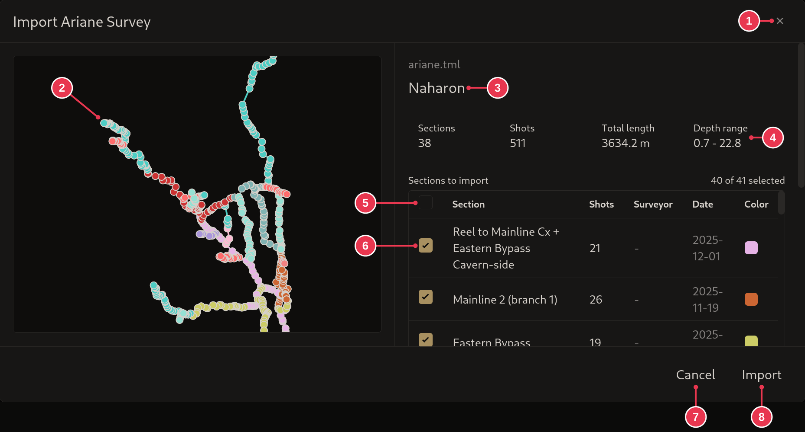
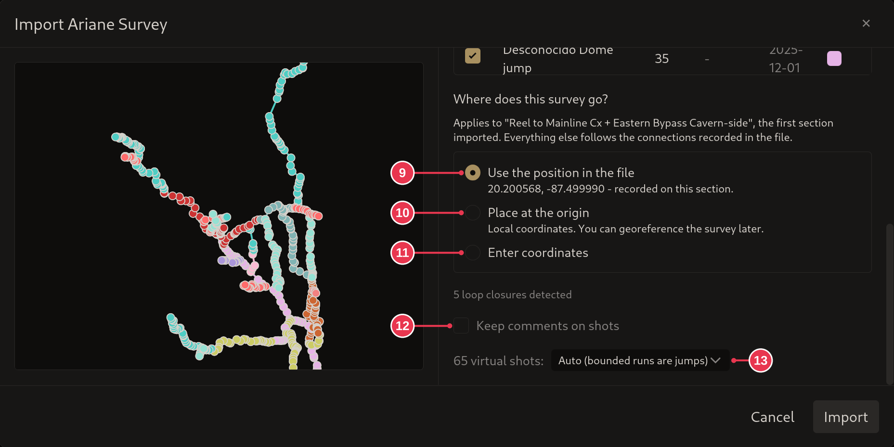

# Import Ariane Survey dialog

Shows what is in an Ariane `.tml` / `.tmlu` file and imports it. Comes after
the [Create Project for Import dialog](create-project-for-import.md).

1. **Close**: nothing imported.
2. Outline of the survey.
3. File and cave name.
4. What will be imported: sections, shots, total length, depth range. Updates
   as you pick sections.
5. Select all or none.
6. Tick the sections to import.
7. **Cancel**
8. **Import**, followed by the [import report](import-report.md).

Scrolled down, the import options:

9. **Use the position in the file** (default): place the survey at the
   [zero datum](../concepts/sections-shots-stations.md) recorded in the Ariane
   file.
10. **Place at the origin**: no real-world position. It can be
    [set later](../workflows/setting-a-zero-datum.md).
11. **Enter coordinates**: type the position yourself.
12. **Keep comments on shots**: see below.
13. Virtual shots: how they are imported, see below.

**Comments.** Stalagmight has comments on both shots and stations. Ariane only
has shot comments, but shows each on the shot's end station. By default the
comments are put on those end stations, as Ariane shows them. Tick 12 to keep
them on the shots.

**Virtual shots.** Ariane does not tell [jumps from references](../concepts/sections-shots-stations.md):

- **Auto (bounded runs are jumps)** (default): Stalagmight's best guess. A run
  of virtual shots with real survey at both ends becomes a jump, any other a
  reference.
- **All jumps**
- **All references**

## Details

- The position (9-11) applies to the first section imported. Everything else
  follows the connections recorded in the file.
- **Include excluded shots** appears when the file has shots marked excluded.
- A section marked **(moved to origin)** connects to nothing else being
  imported, so it is placed at the origin. **(branch)** marks a section split
  off at a branch.
- Imperial files are converted to metric.
