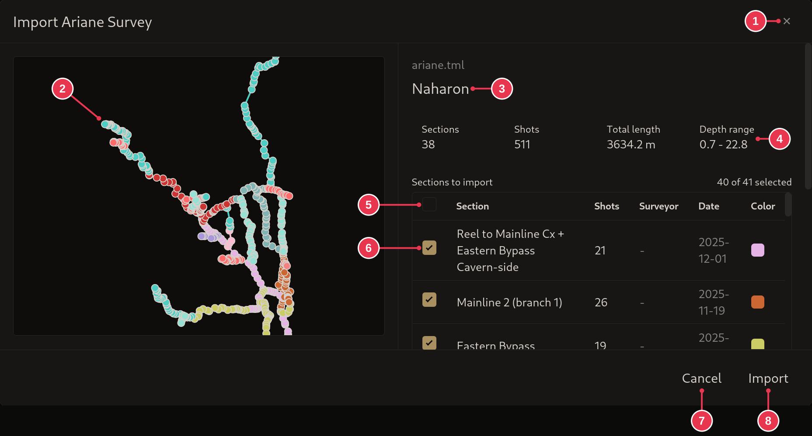
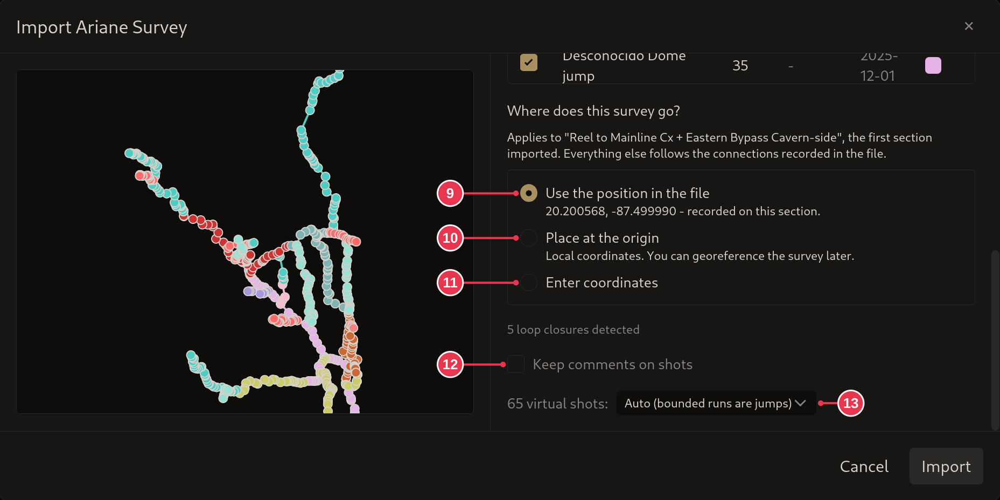

# Import Ariane Survey dialog

Shows what is in an Ariane `.tml` / `.tmlu` file and imports it. Comes after
the [Create Project for Import dialog](create-project-for-import.md).

1. **Close**: nothing imported.
2. Outline of the survey.
3. File and cave name.
4. What will be imported: lines, shots, total length, depth range. Updates
   as you pick lines.
5. Select all or none.
6. Tick the lines to import. Each row shows the line's color, shots,
   **Surveyors**, **Explorers** and date. (The screenshot shows older
   Surveyor and Color columns.)
7. **Cancel**
8. **Import**, followed by the [import report](import-report.md).

Scrolled down, **Where does this survey go?** and the import options:

9. **Use the position in the file** (default): place the survey at the GPS
   position recorded in the Ariane file. Only offered when the file has one.
10. **Place at the origin**: no real-world position. It can be
    [set later](../workflows/setting-a-zero-datum.md).
11. **Enter coordinates**: type the **Latitude** and **Longitude** in decimal
    degrees.
12. **Keep comments on shots**: see below.
13. Virtual shots: how they are imported, see below.

**Comments.** Stalagmight has comments on both shots and stations. Ariane only
has shot comments, but shows each on the shot's end station. By default the
comments are put on those end stations, as Ariane shows them. Tick 12 to keep
them on the shots.

**Virtual shots.** Ariane does not tell [jumps from references](../concepts/sections-shots-stations.md):

- **Auto (bounded runs are jumps)** (default): Stalagmight's best guess. A run
  of virtual shots with real survey at both ends becomes a jump, any other a
  reference.
- **All jumps**
- **All references**

## Where each line goes

- The position (9-11) applies to the first line imported, named above the
  options. With 9 or 11 it gets the project's first
  [zero datum](../concepts/zero-datums-and-gps-fixes.md).
- Every other line follows its connection in the file.
- A line that starts at another entrance with its own GPS position in the
  file is placed there, with a zero datum of its own. A cave with several
  GPS-tagged entrances so gets one zero datum per entrance, each placing its
  own piece of the survey.
- A line marked **(moved to origin)** connects to nothing else being
  imported and has no GPS position, so it is placed at the origin. The import
  report lists it.

## Details

- The total length (4) counts every shot, virtual ones included. Which of them
  become references, and so drop out of the project's length, is settled on
  import.
- A tick box such as **Include 4 excluded shots** appears when the file has
  shots marked excluded.
- **Keep comments on shots** appears only when the file has comments, and the
  virtual shots choice only when it has virtual shots.
- **(branch)** marks a line split off at a branch.
- Imperial files are converted to metric.
- Cancelling, or an import that fails, leaves the new project empty. You are
  asked to **Keep empty project** or **Discard it**.
