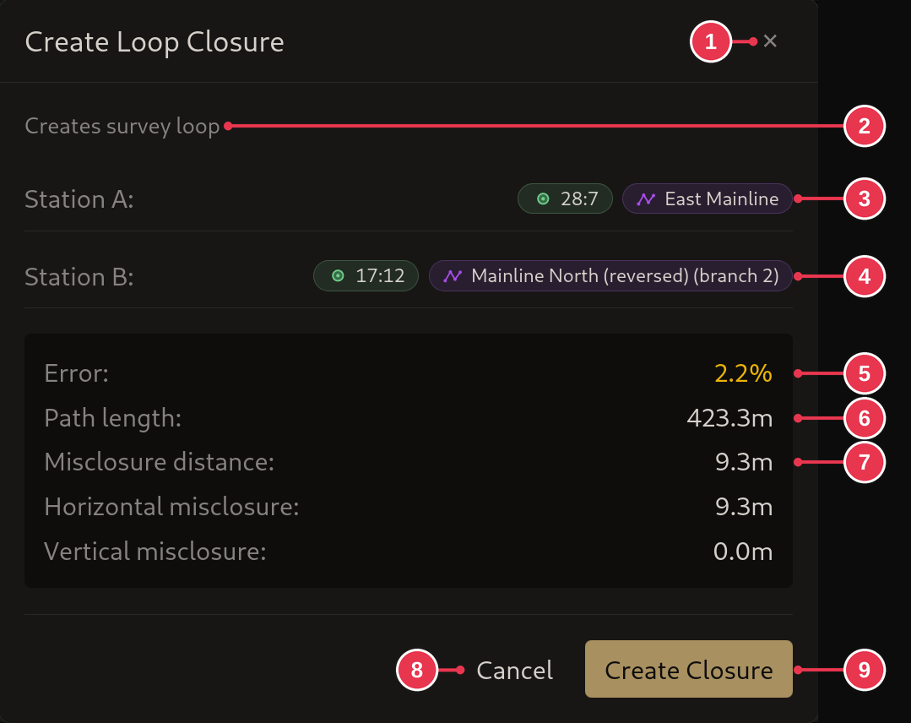

# Create Loop Closure dialog

Shows which two stations close the loop, and how far the survey misses. Opens
instead of the merge dialog when the stations cannot be merged, see
[Closing a loop](../workflows/closing-a-loop.md).

1. **Close**: nothing created.
2. Why a closure is offered.
3. **Station A**: the first station clicked, and its section.
4. **Station B**: the second station clicked, and its section.
5. **Error**: misclosure distance (7) as a share of path length (6).
6. **Path length**: the survey length around the loop.
7. **Misclosure distance**: how far apart the two stations are. Split into
   horizontal and vertical below it.
8. **Cancel**: same as 1.
9. **Create Closure**

## Details

- The error color: green under 1%, yellow under 3%, orange under 5%, red from
  5%.
- Creating the closure does not move the survey. See
  [loop closure](../concepts/sections-shots-stations.md).
