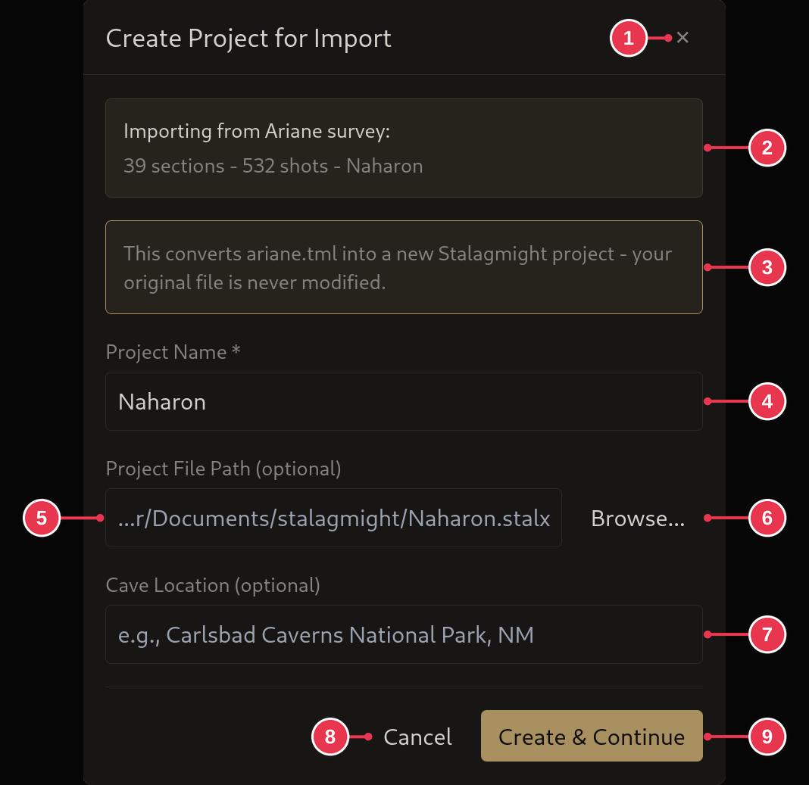

# Create Project for Import dialog

Opening a survey from another program (Ariane, MNemo, Compass, Walls, GPX) on
the [start screen](start-screen.md) first creates a new project to import it
into.

1. **Close**: nothing created.
2. What is being imported.
3. The original file is never changed.
4. **Project Name**: required.
5. **Project File Path**: where the `.stalx` file goes. Left empty, it uses the
   path shown.
6. **Browse...**: pick the path in a file browser.
7. **Cave Location**: optional. Where the cave is.
8. **Cancel**: same as 1.
9. **Create & Continue**: on to the import.

## Details

- The default path is `Documents/stalagmight/<name>.stalx`.
- The project file is only written once the import brings data in. Cancelling
  before that leaves no file behind.
