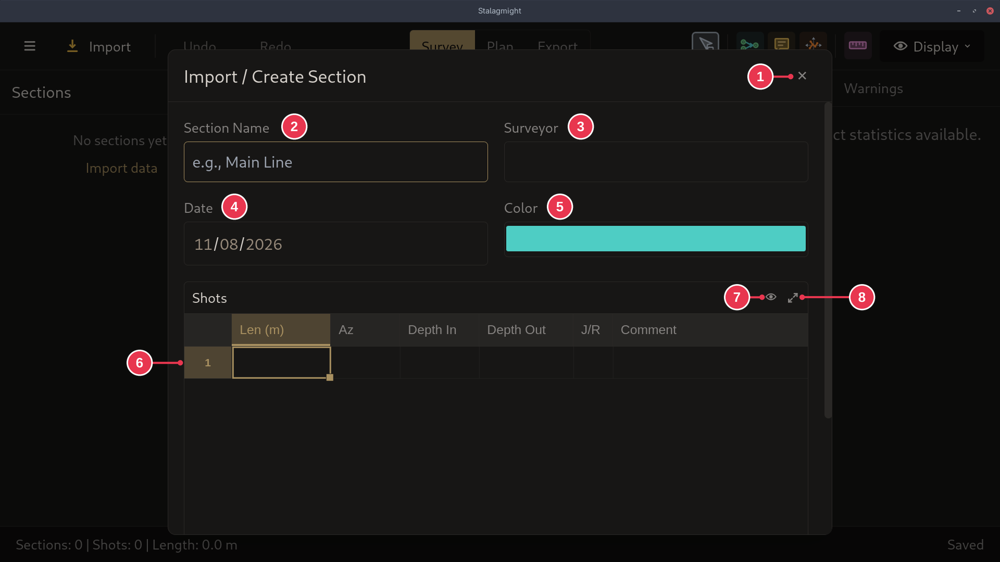
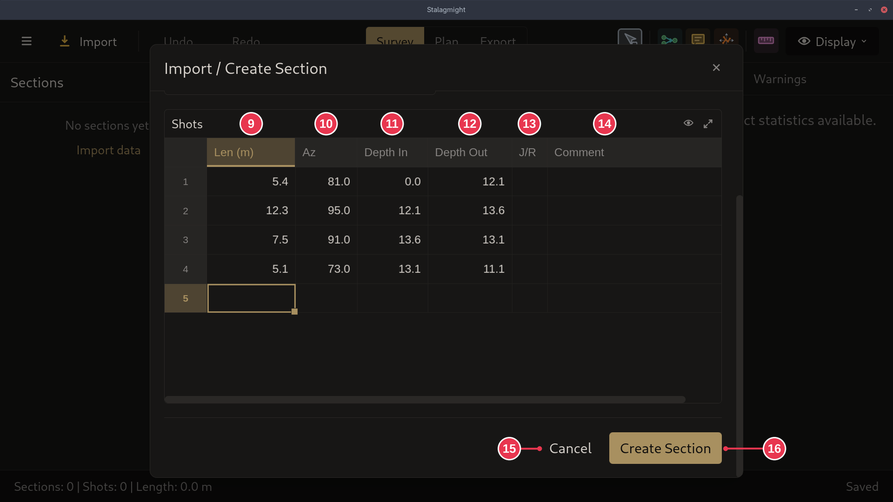
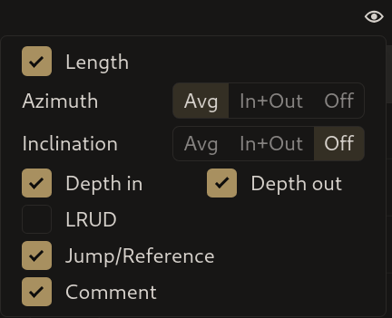

# Import / Create Section dialog

Creates a section from shots you type or paste in. Opened by **Add section** in
the [survey view](survey-view.md).

1. **Close**: nothing created.
2. **Section Name**
3. **Surveyor**
4. **Date**: when the line was surveyed.
5. **Color**: the section's color on the map.
6. **Shots**: one row per shot.
7. **Choose visible columns**, including the extra columns hidden by default:
   LRUD, and azimuth and inclination per end of the shot.
8. Enlarge the table.

9. **Len**: shot length.
10. **Az**: azimuth.
11. **Depth In**: depth at the start of the shot.
12. **Depth Out**: depth at the end of the shot.
13. **J/R**: shot kind. Blank is permanent line, `J` is a jump, `R` is a
    reference. Click the cell to change it. See
    [shot kinds](../concepts/sections-shots-stations.md).
14. **Comment**
15. **Cancel**: same as 1.
16. **Create Section**: creates the section, then you place it on the map in
    [placement mode](placement-mode.md).

## Details

- Extra columns in 7, hidden by default:

  

  - **LRUD**: passage size, as `L`, `R`, `U`, `D`.
  - **Azimuth**: `Avg` (default) is one value per shot. `In+Out` gives
    `Az In` and `Az Out`, for surveyors who read the azimuth at both ends.
  - **Inclination**: same choices, `Off` by default. It can be typed in, but is
    mainly filled by MNemo imports.
- **Create Section** needs at least one complete shot. A half-filled row has to
  be completed or deleted first.
- After **Create Section**, placing the section on an existing station merges
  the two.
- Shift+click on a **J/R** cell steps backwards.
- Name, surveyor and date are optional. Color starts as the next unused section
  color.
- The length unit is shown in the column header.
- You can paste rows copied from a spreadsheet into the table.
