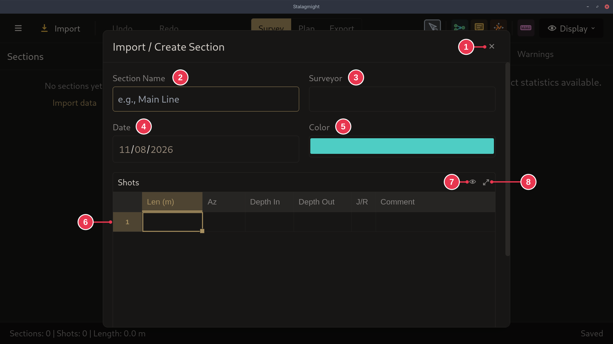
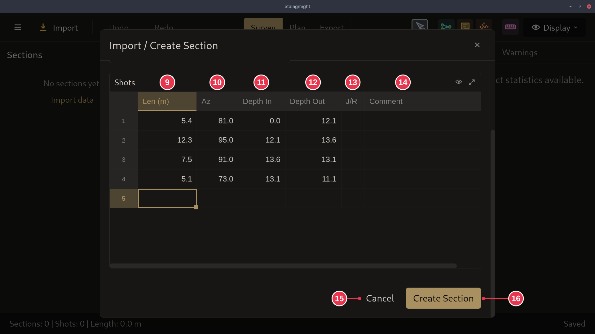
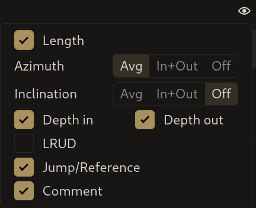

# Import / Create Line dialog

Creates a line from shots you type or paste in. Opened by **Add line** in
the [survey view](survey-view.md).

1. **Close**: nothing created.
2. **Line Name**
6. **Shots**: one row per shot.
7. **Choose visible columns**, including the extra columns hidden by default:
   LRUD, and azimuth and inclination per end of the shot.
8. Enlarge the table.

The picture shows an older layout (callouts 3 to 5). The fields between the
name and the shots are now:

- **Survey date**: when the line was surveyed. Empty by default (**No date**);
  the **Clear date** button beside a date empties it again.
- **Color**: the line's color on the map.
- **Section**: shown once the project has
  [sections](../workflows/grouping-lines-into-sections.md). The line goes
  straight into the section picked here; **No section** by default.
- **Surveyors** and **Explorers**: lists of people. Type a name and press
  **Enter** (or `;`) to add it. Suggestions come from the project, from names
  you entered before and, for a SpeleoDB project, from its collaborators.

The surveyors, explorers and survey date go on every shot you enter here.

9. **Len**: shot length.
10. **Az**: azimuth.
11. **Depth In**: depth at the start of the shot.
12. **Depth Out**: depth at the end of the shot.
13. **J/R**: shot kind. Blank is permanent line, `J` is a jump, `R` is a
    reference. Click the cell to change it. See
    [shot kinds](../concepts/sections-shots-stations.md).
14. **Comment**
15. **Cancel**: same as 1.
16. **Create Line**: creates the line, then you place it on the map in
    [placement mode](placement-mode.md).

## Details

- Extra columns in 7, hidden by default:

  

  - **LRUD**: passage size, as `L`, `R`, `U`, `D`.
  - **Azimuth**: `Avg` (default) is one value per shot. `In+Out` gives
    `Az In` and `Az Out`, for surveyors who read the azimuth at both ends.
  - **Inclination**: same choices, `Off` by default. It can be typed in, but is
    mainly filled by MNemo imports.
- **Create Line** needs at least one complete shot. A half-filled row has to
  be completed or deleted first.
- After **Create Line**, placing the line on an existing station merges
  the two.
- Shift+click on a **J/R** cell steps backwards.
- Name, people and date are optional. Color starts as the next unused line
  color.
- Surveyors and explorers start with the people of the last line you
  created or imported with the MNemo import since the app started.
- The length unit is shown in the column header.
- You can paste rows copied from a spreadsheet into the table.
- In a read-only view the dialog says a line cannot be created.
