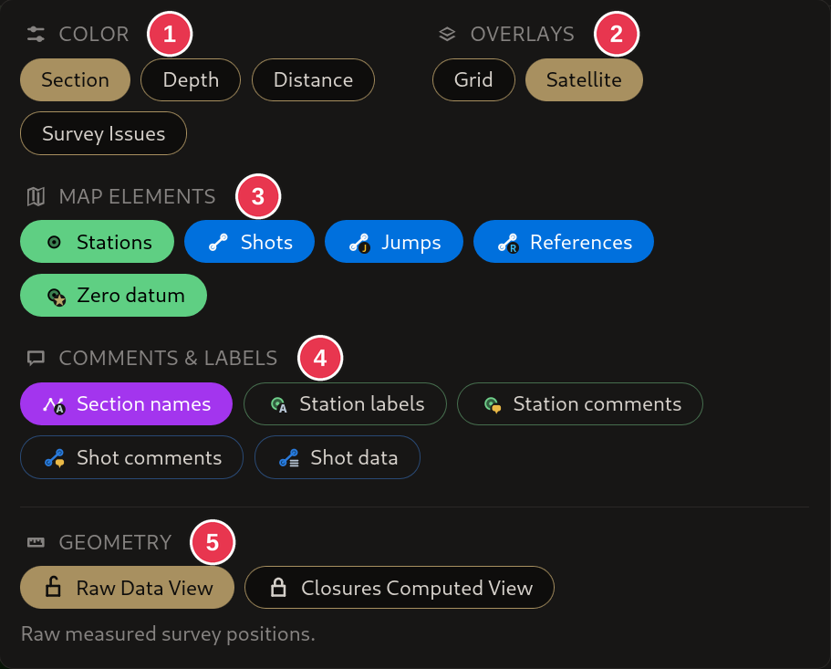

# Display menu

What the map shows. Opened by **Display** in the top right of the
[survey view](survey-view.md). Highlighted options are on.

1. **Color**, one at a time:
   - **Section**: each section in its own color.
   - **Depth**: color by depth.
   - **Distance**: color by distance along the cave from the entrance. Click a
     station to measure from there instead.
   - **Survey Issues**: each shot by how far its readings disagree: green
     where they agree, yellow at a warning threshold, red at three times it or
     for an error. A legend shows the scale. See
     [Errors and warnings](../concepts/errors-and-warnings.md).
2. **Overlays**: **Grid** and **Satellite** imagery.
3. **Map elements**: **Stations**, **Shots**, **Jumps**, **References** and
   **Zero datum** stations.
4. **Comments & labels**: **Section names**, **Station IDs**, **Station
   names**, **Station comments**, **Shot comments**, **Shot data** and **Errors**
   labels. **Errors** labels each shot with how far its readings disagree, for
   example `Δaz 23.4° Δinc 4.0° Δi/d -10.0° ΔL +0.4m`, and each loop closure with
   its error, for example `Loop 2.1% 0.84m`. The legend explains the
   abbreviations.
5. **Geometry**:
   - **Raw Data View**: the survey as measured.
   - **Closures Computed View**: corrected by the
     [loop closures](../workflows/closing-a-loop.md). Read-only.

## Details

- **Grid** adds a **Grid spacing** setting.
- **Station IDs** and **Station names** label the stations in two ways, and
  only one can be on: turning one on turns the other off. **Station names**
  shows each station's name, such as the mNemo station number from a `.dmp`
  import, and stations without a name get no label. It is unavailable when
  the project has no station names.
- **Closures Computed View** is unavailable when there are no loop closures to
  adjust. Edit in the **Raw Data View**.
- **Errors** labels: a value that rounds to zero is left out, and so is one
  whose warning you ignored. ΔL appears only on shots steeper than 15°; on a
  flatter shot a small inclination error would change it by metres. Where labels
  overlap, the worst error is shown. Shot labels hide with **Shots**, loop
  closure labels with **Stations**.
- While the [Warnings tab](warnings-panel.md) is open, **Survey Issues** and
  **Errors** are on and marked as automatic. Changes you make then last until
  you leave the tab, and are not saved. Leaving the tab brings your own choices
  back.
- The choices are remembered between sessions, except **Distance** and
  **Survey Issues** coloring.
