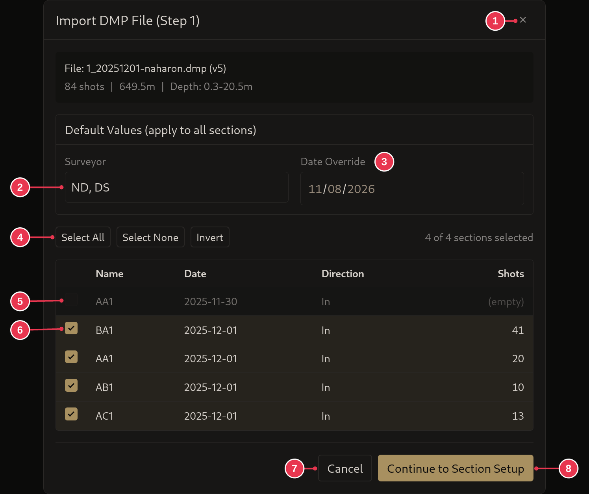
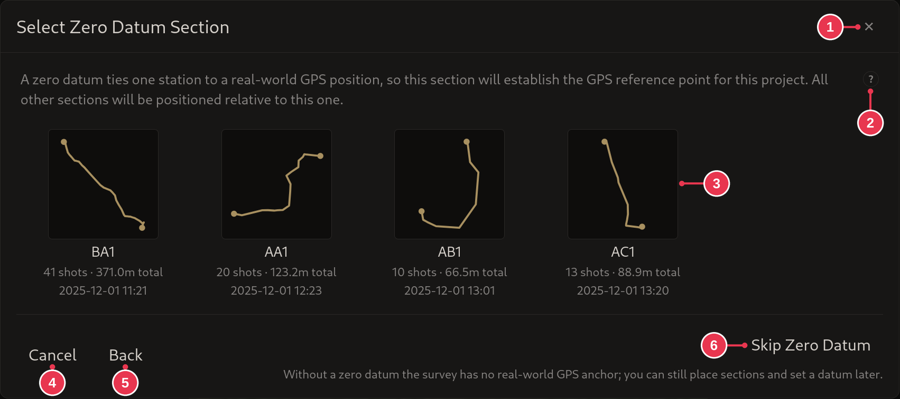
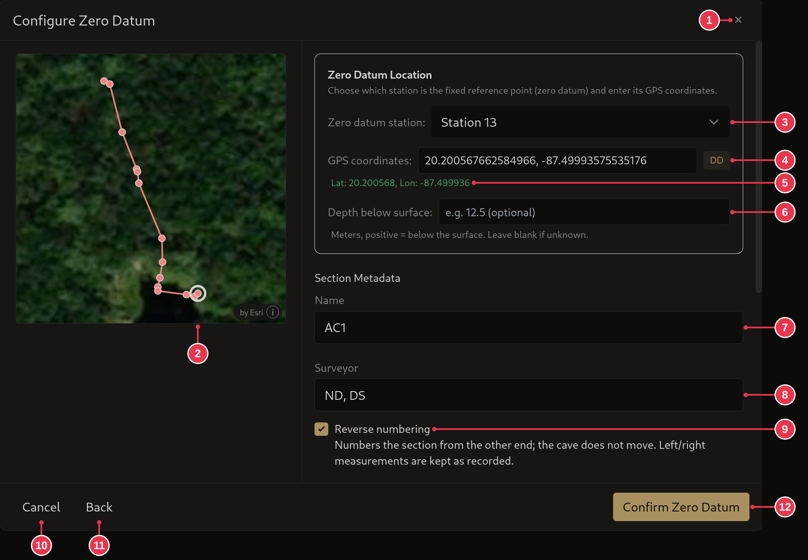
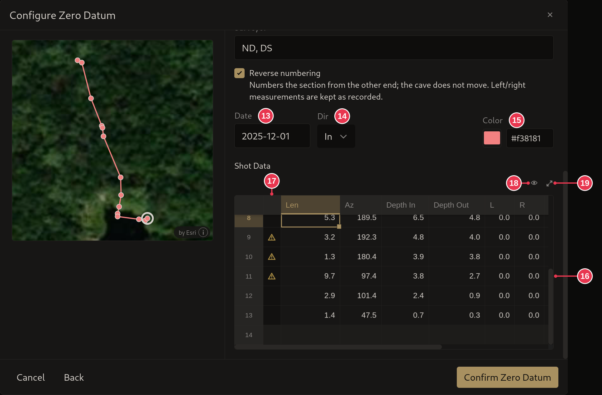
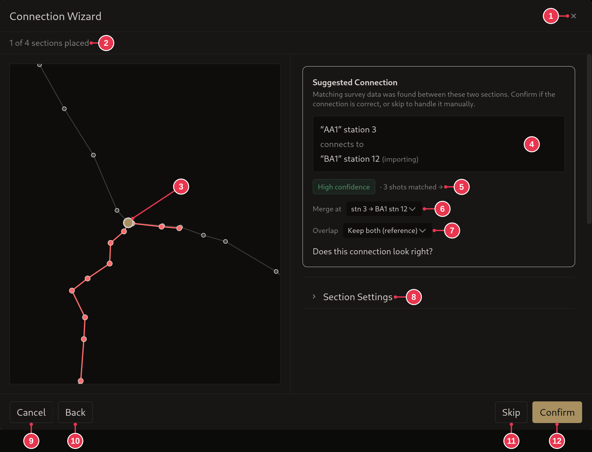
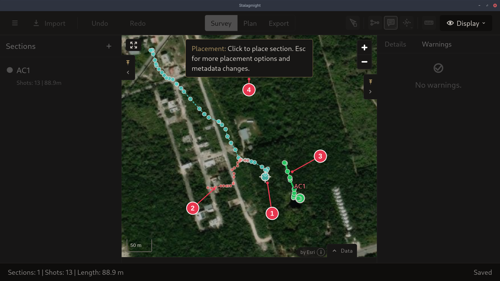
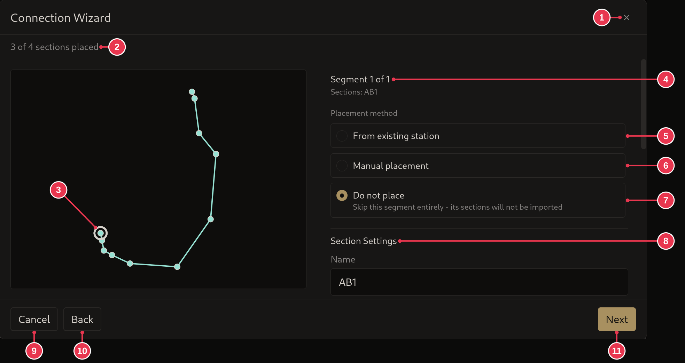

# DMP import

Imports an MNemo `.dmp` file into the open project, in steps. Opened by
**Import** in the [survey view](survey-view.md).

## Step 1: pick sections

1. **Close**: nothing imported.
2. **Surveyor**: for every imported section.
3. **Date Override**: one date for every section, instead of the dates in the
   file.
4. **Select All**, **Select None**, **Invert**
5. An empty section. It has no shots and can't be picked.
6. Tick the sections to import.
7. **Cancel**: same as 1.
8. **Continue to Section Setup**

### Details

- Sections already imported into this project are marked **(already imported)**
  and left unticked. A whole file imported before gets a warning at the top.
- The box at the top shows the file, its number of shots, total length and
  depth range.
- **Direction**: whether the line was surveyed going in or out.

## Step 2: zero datum (optional)

Only shown when the project has no
[zero datum](../concepts/sections-shots-stations.md) yet.

1. **Close**: nothing imported.
2. Help on zero datums.
3. Click the section that should carry the zero datum. Next you pick its
   station and GPS position.
4. **Cancel**: same as 1.
5. **Back**: to step 1.
6. **Skip Zero Datum**: import without one. It can be
   [set later](../workflows/setting-a-zero-datum.md).

## Step 3: zero datum station and position

After picking a section in step 2.

1. **Close**: nothing imported.
2. Preview. The ring marks the zero datum station. Click a station to pick it.
3. **Zero datum station**
4. **GPS coordinates**, in any [GPS format](edit-station-dialog.md#gps-formats).
   The badge shows the format it was read as.
5. The position as read from 4.
6. **Depth below surface**: optional, in meters, positive below the surface.
7. **Name**
8. **Surveyor**
9. **Reverse numbering**: number the stations and shots from the other end
   (ticked here). The cave does not move.
10. **Cancel**: same as 1.
11. **Back**: to step 2.
12. **Confirm Zero Datum**: disabled until 4 can be read.

Scrolled down, the section's details and shots:

13. **Date**
14. **Dir**: surveyed going in or out.
15. **Color**
16. **Shot Data**: every shot of the section. Values can be changed here, or
    any time later.
17. A ⚠ in this column marks a shot with a warning. Hover it to read it.
18. Choose visible columns.
19. Enlarge the table.

## Step 4: connection wizard

Stalagmight matches [reference shots](../concepts/sections-shots-stations.md)
between sections and suggests where each section joins, one at a time.

1. **Close**
2. Sections placed so far.
3. Preview: grey is already placed, red is the section being placed, the gold
   dot is where they join.
4. The suggested connection: which station joins which.
5. Confidence (high, medium or low) and how many shots matched. The arrow shows
   whether they run the same way (→) or opposite ways (←).
6. **Merge at**: pick another station pair, when there is more than one.
7. **Overlap**: what to do with shots that were surveyed twice, see below.
8. **Section Settings**: the section's name, surveyor, date, color and
   direction.
9. **Cancel**: asks whether to keep or remove sections already imported.
10. **Back**: starts the import over. Sections this wizard already imported are
    removed first, which can be undone.
11. **Skip**: leave this section for now and place it by hand at the end.
12. **Confirm**: accept the connection.

**Overlap**:

- **Keep both (reference)**: keep both copies. The new ones become reference
  shots.
- **Use import data**: keep one copy, with the new values.
- **Use existing data**: keep one copy, with the values already in the project.
- **Interpolate**: keep one copy, averaging the two.

### Details

- Scroll down for the section's shot table. Edit it here if needed, or later.
- **Use import data** and **Interpolate** are greyed out when the existing shots
  are pinned on both sides, by a zero datum, a merge or a closure.
- The overlap choice is remembered for the project.

## Step 5: place the rest by hand

Sections with no suggested connection, and skipped ones, are placed by clicking
the map, like [placement mode](placement-mode.md). Sections joined to each other
move together.

It does not need to be accurate. Move them later, or connect them once the
survey has the data to do it.

1. The station under the pointer. Click the map to drop the sections there.
2. The sections being placed, dashed.
3. Sections already placed, solid.
4. **Esc**: back to the wizard, for
   [other ways to place them](#step-6-other-placement-options).

## Step 6: other placement options

**Esc** in step 5 opens the options for the segment, a group of joined sections
still to place.

1. **Close**
2. Sections placed so far.
3. Preview of the segment. The ring is the anchor station, the one that lands
   where you click. Click another station to change it.
4. Which segment, and its sections.
5. **From existing station**: join it to a station already in the project.
6. **Manual placement**: click the map, as in step 5.
7. **Do not place**: leave this segment out of the import.
8. **Section Settings**: name and other details.
9. **Cancel**
10. **Back**
11. **Next**

### Details

- **Suggested connection** is offered too, when a suggestion for this segment
  was skipped.
