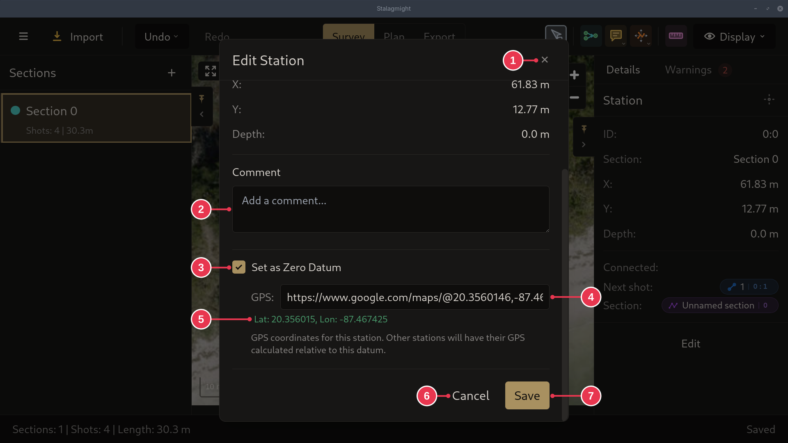

# Edit Station dialog

Opened by **Edit Station** or **Set Zero Datum** in the
[station context menu](station-context-menu.md).

1. **Close**: nothing changed.
2. **Comment**
3. **Set as Zero Datum**: make this station a
   [zero datum](../concepts/zero-datums-and-gps-fixes.md). Untick it to
   remove the zero datum.
4. **GPS**: the station's position, in any format below.
5. The position as read from 4. Check it before saving.
6. **Cancel**: same as 1.
7. **Save**: what moves depends on the zero datum's role, below.

## Zero datum

Under **GPS** (4), once the GPS reads, the dialog shows more than the
screenshot above:

- **Role:** for a zero datum already saved. "places this part of the survey on
  its GPS" for the placement datum of its piece, or "GPS fix", which bends the
  Closures Computed View toward its GPS and does not move the Raw Data View.
- For a new zero datum on a piece that already has one, a notice that this
  one will be a GPS fix.
- The gap, for a GPS fix: how far its GPS is from where the survey puts the
  station, for example "GPS is 4.2 m NE of the surveyed position." When that
  is more than expected, a warning says so; you can still save. See
  [The far GPS fix warning](../concepts/zero-datums-and-gps-fixes.md#the-far-gps-fix-warning).
- **Accuracy (m)**, GPS fixes only: 0 (the default) puts the computed survey
  exactly through the GPS; a larger number, up to 1000, trusts the GPS less.
- **Entrance**: whether this zero datum is a way into the cave, which Plan
  mode and the **Distance** color start from. Always ticked, and greyed out,
  for the placement datum. For a GPS fix it starts ticked at the first or
  last station of a line and unticked elsewhere.

**Save** with a new GPS moves the station, and everything connected to it, to
that position when it is the placement datum of its piece. For the first zero
datum of the project, every other placed piece stays on its own GPS. A GPS
fix moves nothing in the Raw Data View. See
[How roles change](../concepts/zero-datums-and-gps-fixes.md#how-roles-change).

## GPS formats

| Format | Example |
|--------|---------|
| Decimal degrees | `48.8584, 2.2945` |
| Degrees, minutes, seconds | `48°51'30"N 2°17'40"E` |
| Degrees, decimal minutes | `48°51.5'N 2°17.67'E` |
| UTM | `31U 448251 5411932` |
| Plus Code (full) | `8FW4V75V+8Q` |
| Google Maps link | `https://www.google.com/maps/@48.8584,2.2945,15z` |
| OpenStreetMap link | `https://www.openstreetmap.org/#map=15/48.8584/2.2945` |
| Bing Maps link | `https://www.bing.com/maps?cp=48.8584~2.2945` |

## Details

- Not supported: MGRS and What3words (recognised, but not converted), short
  Plus Codes, shortened links (`goo.gl`) and Apple Maps links.
- For typed coordinates, the detected format is shown next to 4.
- ID, line, X, Y and depth at the top of the dialog are read-only.
- **Save** is unavailable in the Closures Computed View, Plan and Export.
