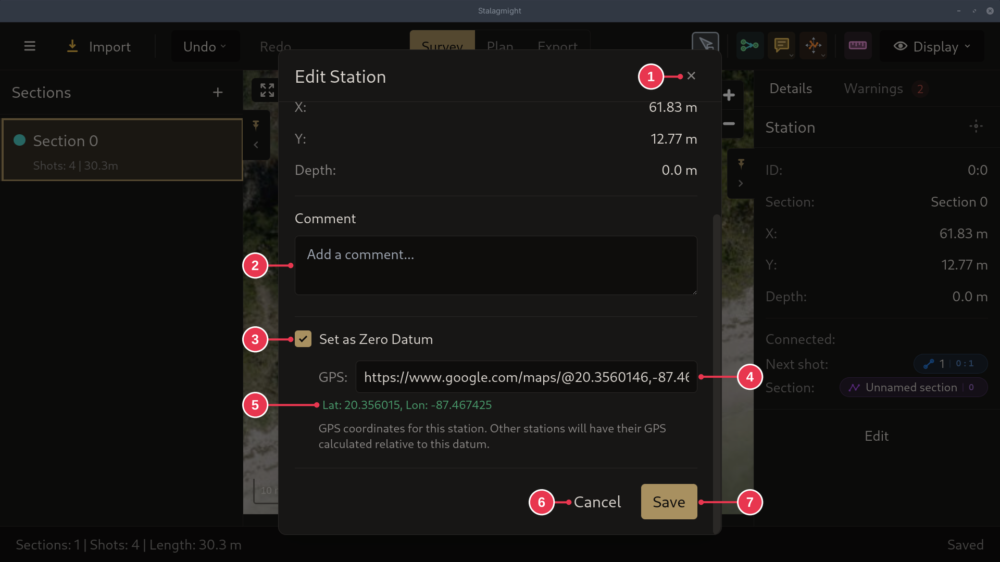

# Edit Station dialog

Opened by **Edit Station** or **Set Zero Datum** in the
[station context menu](station-context-menu.md).

1. **Close**: nothing changed.
2. **Comment**
3. **Set as Zero Datum**: make this station the
   [zero datum](../concepts/sections-shots-stations.md).
4. **GPS**: the station's position, in any format below.
5. The position as read from 4. Check it before saving.
6. **Cancel**: same as 1.
7. **Save**: the station, and everything connected to it, moves to that
   position on the map.

## GPS formats

| Format | Example |
|--------|---------|
| Decimal degrees | `48.8584, 2.2945` |
| Degrees, minutes, seconds | `48°51'30"N 2°17'40"E` |
| Degrees, decimal minutes | `48°51.5'N 2°17.67'E` |
| UTM | `31U 448251 5411932` |
| Plus Code (full) | `8FW4V75V+8Q` |
| Google Maps link | `https://www.google.com/maps/@48.8584,2.2945,15z` |
| OpenStreetMap link | `https://www.openstreetmap.org/#map=15/48.8584/2.2945` |
| Bing Maps link | `https://www.bing.com/maps?cp=48.8584~2.2945` |

## Details

- Not supported: MGRS and What3words (recognised, but not converted), short
  Plus Codes, shortened links (`goo.gl`) and Apple Maps links.
- For typed coordinates, the detected format is shown next to 4.
- ID, section, X, Y and depth at the top of the dialog are read-only.
