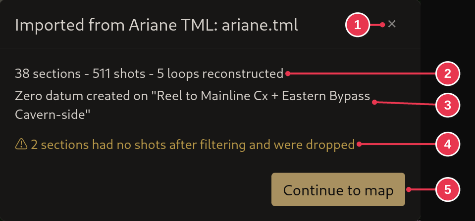

# Import report

Shown after an import from another format: what was imported, and anything that
did not come in as it was.

1. **Close**
2. Sections, shots and loops imported, and how many sections are not connected
   to a [zero datum](../concepts/zero-datums-and-gps-fixes.md) when some are
   not.
3. Where the zero datum was set. When the import set several, one per
   GPS-tagged entrance, the line names the first and adds how many more.
4. Warnings. Here two sections had no shots left and were not imported.
5. **Continue to map**

## Details

- It only opens when there is something to read: a warning, nothing imported,
  a unit conversion, or a zero datum set by the import. Otherwise a short
  notification appears instead.
- The first three warnings are shown. More fold behind **View details**.
- Everything listed has already happened. Closing the report changes nothing.
- An Ariane file exported by Stalagmight writes each GPS fix as an extra
  entrance. Importing it back does not restore the fixes: the report lists them
  as sections with no shots and loop closures that were skipped.
- Problems in the survey data itself are in the
  [Warnings panel](warnings-panel.md).
