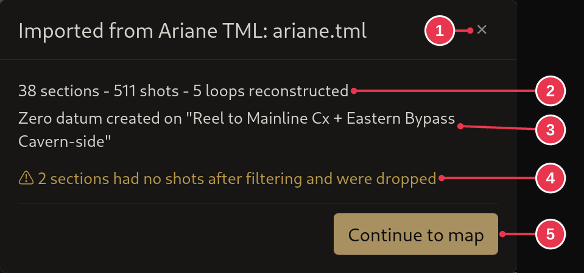

# Import report

Shown after an import from another format: what was imported, and anything that
did not come in as it was.

1. **Close**
2. Sections, shots and loops imported.
3. Where the [zero datum](../concepts/sections-shots-stations.md) was set.
4. Warnings. Here two sections had no shots left and were not imported.
5. **Continue to map**

## Details

- It only opens when there is something to read: a warning, nothing imported,
  or a unit conversion. Otherwise a short notification appears instead.
- A long list of warnings folds behind **View details**.
- Everything listed has already happened. Closing the report changes nothing.
- Problems in the survey data itself are in the
  [Warnings panel](warnings-panel.md).
