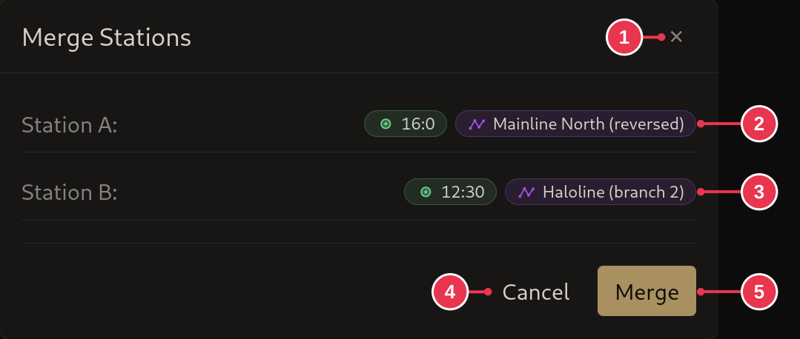

# Merge Stations dialog

Confirms which two stations get merged. Opens after the second click with the
**Merge** tool, see [Merging stations](../workflows/merging-stations.md).

1. **Close**: nothing merged.
2. **Station A**: the first station clicked, with its line: `Main Line / 17`.
3. **Station B**: the second station clicked, with its line.

The picture shows the older form, a number such as `16:0` beside the line's
name. Each station is now one pill with its line and name.
4. **Cancel**: same as 1.
5. **Merge**

**Keep** chooses which station the merged station is: one choice per
station, each a pill with its line, name and Station ID. The kept station is
shown on every line through the merged station; the other is archived with
its name and comment ("Side / 0 is archived with its comment"), and
**Detach Line from Station** brings it back. The dialog preselects the
station that holds a zero datum or GPS fix, else the one on the longest
line. If a loop closure joins the two stations and hides one of them, the
dialog keeps the one it shows and says why. A station another loop closure
hides (its choice says "shown as ... through a loop closure") keeps showing
that closure's station when you keep it; when you keep the other station
instead, the closure stays but stops hiding its end, so the station you kept
is shown there too, and the dialog says so. The lines that show the kept
station anew show its pill in its own line's colour (a Main pill on Side,
named "Main: 12", where a station of Side's own is in Side's colour), and
such a station does not take up its name there: if Side already has a
station `12` of its own, it keeps it, and Side shows both `12`s, one in
Main's colour; the dialog says so before you merge ("Side already has a
station 12 (Station ID 27); it keeps its name, and Side shows 12 twice, the
junction in Main's colour"). A shot that starts or ends at such a station
is drawn in two colours, split at the arrow: the half with that end in
Main's colour, with Main's dot after its name. Texts without colours name
the station `12 (Main)`, and so does the data table's Name column, in a
lighter colour. Only when
the merge would make a line show one name for two stations of its own (a
loop closure it changes, for example) does a row ask how to settle it:
rename the other station (for example `12` to `12a`) or rename the kept
one. Both stations have one name, so each choice says which it renames, by
its Station ID ("Rename the 12 that is on Side now (Station ID 27) to 12a", "Rename the
kept station (Main / 12, Station ID 12) to 12a"). When the archived station
was itself a junction of earlier merges, it is archived whole, with the
stations archived in it still inside it, and the dialog names them:
**Detach Line from Station** on any of its lines gives that junction back on
all of them. A comment the merge hides in another way (a loop closure the
merge turns into a junction) is named too; **Undo** brings it back.

When both pieces are already placed by their own
[zero datum](../concepts/zero-datums-and-gps-fixes.md), a note under the
stations says which piece moves, how far it moves to meet the other one, and
that its zero datum becomes a GPS fix.

## Details

- One side moves onto the other, together with everything already merged to
  it:
  - Only one side has a zero datum: that side stays put and the other moves.
  - Neither has one: station A's side moves onto station B.
  - Both have one: one piece keeps its place and the other moves, as the note
    says. The zero datum of the piece that moves stays, as a
    [GPS fix](../concepts/zero-datums-and-gps-fixes.md): it no longer moves the
    Raw Data View, and the Closures Computed View bends the survey toward it.
- When the merge comes from dragging a station onto another with a move tool,
  the note says that the piece moves, but not how far.
- If a loop closure joined the two stations you merge, the merge removes it and
  says so.
- If a station you picked is already where several lines meet, the dialog
  says so ("Main Line / 8 is already where Main Line and Far Room meet"). When
  the two depths differ, it lists every depth reading the joined station
  averages, each with its line: "Depths 4.0 m (Upstream), 12.5 m (Main Line),
  12.5 m (Far Room) become 9.7 m". A station inside a line has two readings,
  the depth out of the shot before it and the depth in of the shot after it;
  when they are equal the list gives them once, counted: "7.8 m (Main, 2
  readings)".
- Which station is kept changes only names: the survey is placed the same
  either way. The archived station keeps its own name and
  [Station ID](../concepts/sections-shots-stations.md#names-and-station-ids)
  inside the merged station, and the merge never joins two comments.
- **Undo** reverses a merge, and brings back a loop closure it removed.

The dialog does not open when:

- The two stations are already merged, or a loop closure already joins them. A
  notification says so.
- Their lines are already connected: they are on one line, or joined
  through other merges and loop closures. Merging would make a loop, so the
  [Create Loop Closure dialog](closure-dialog.md) opens instead.
