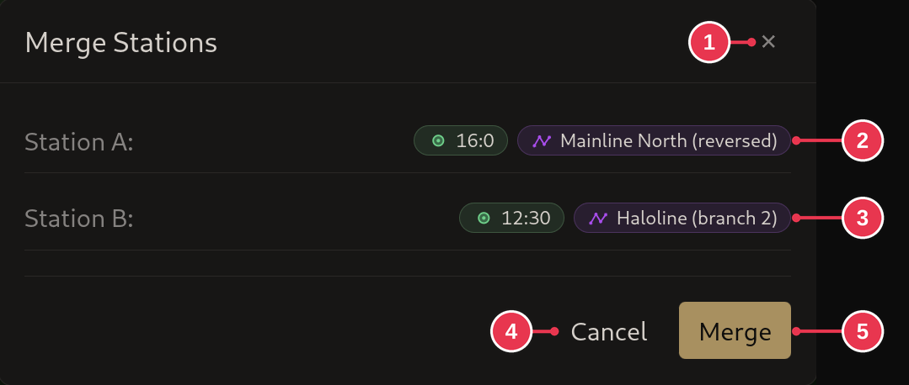

# Merge Stations dialog

Confirms which two stations get merged. Opens after the second click with the
**Merge** tool, see [Merging stations](../workflows/merging-stations.md).

1. **Close**: nothing merged.
2. **Station A**: the first station clicked, and its section.
3. **Station B**: the second station clicked, and its section.
4. **Cancel**: same as 1.
5. **Merge**

## Details

- Station A's section moves onto station B, together with everything already
  connected to it. If either side has a
  [zero datum](../concepts/sections-shots-stations.md), that side stays put and
  the other one moves.
- A merge is refused when both stations are on the same section, already
  merged, already connected another way (use a loop closure instead), or when
  both sides have a zero datum.
- **Undo** reverses a merge.
