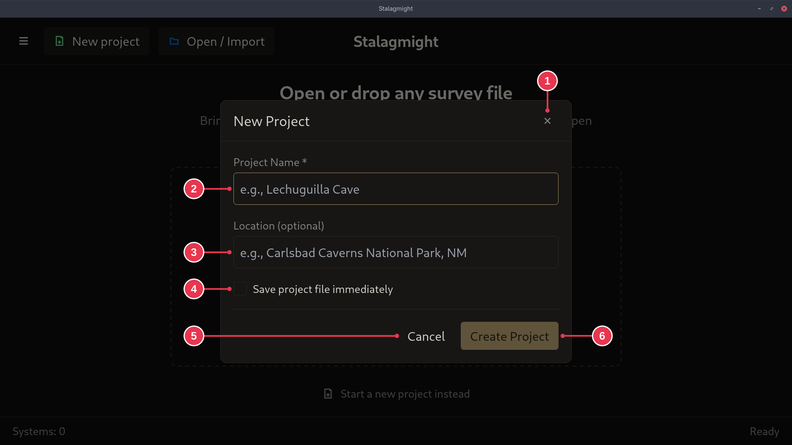

# New Project dialog

Names a new project. Opened by **New project** on the
[start screen](start-screen.md).

1. **Close**: back to the start screen, nothing created.
2. **Project Name**: required.
3. **Location**: optional. Where the cave is, for example a park or region.
4. **Save project file immediately**: creates the `.stalx` file as soon as the
   project opens. Unticked, the file is only saved once you add data.
5. **Cancel**: same as 1.
6. **Create Project**: creates the project and opens it. Disabled until 2 has a
   name.

## Details

- With 4 ticked, **Create Project** first asks where to save the file.
  Cancelling that leaves the project unsaved, as if 4 were unticked.
- With 4 unticked, the file goes to `Documents/stalagmight/<name>.stalx`. If
  that name is taken, `_1`, `_2`, ... is added.
- Signed in to SpeleoDB, the dialog also has **Also create on SpeleoDB after
  creating**.
