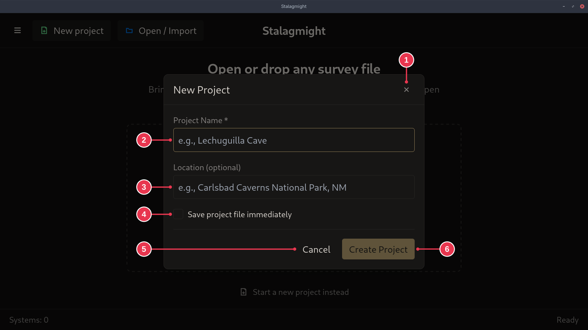

# New Project dialog

Names a new project. Opened by **New project** on the
[start screen](start-screen.md) or in the menu (`Ctrl+N`).

1. **Close**: nothing created.
2. **Project Name**: required.
3. **Location (optional)**: where the cave is, for example a park or region.
5. **Cancel**: same as 1.
6. **Create Project**: creates the project and opens it. Disabled until 2 has a
   name.

The picture still shows a **Save project file immediately** checkbox (4). The
dialog no longer has it: every new project is saved as described below.

## When the file is written

- **Create Project** opens the project straight away but does not write a file
  yet.
- The `.stalx` file is written the first time the project is saved: by
  auto-save shortly after you add data (on by default, see Settings), or when
  you choose **Save** (`Ctrl+S`). Importing data into the new project also
  saves it.
- The file goes to `Documents/stalagmight/<name>.stalx`. Characters other than
  letters and digits in the name become `_`. If that file already exists,
  `_1`, `_2`, ... is added.
- The project is listed under recent projects once it is saved.
- To save it somewhere else, use **Save As** in the menu.

## Details

- Signed in to SpeleoDB, the dialog also has **Create as SpeleoDB project**
  (off by default). Ticked, **Create Project** creates the project and then
  opens **Publish to SpeleoDB**.
- A local project can also be published later from the **SpeleoDB** tab in the
  [survey view](survey-view.md).
