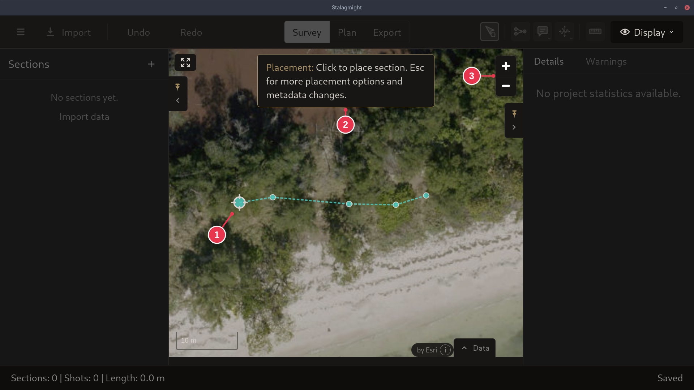

# Placement mode

After **Create Line**, the new line follows the pointer. Click the map to
drop it there. The [DMP import](dmp-import.md#step-5-place-the-rest-by-hand)
uses the same mode for lines it could not connect.

It does not need to be accurate: the line can be moved later, or anchored to
a [zero datum](../concepts/zero-datums-and-gps-fixes.md).

1. The line's first station, under the pointer. It lands where you click.
2. **Esc** goes back to the dialog that started placement, with everything you
   entered. For a hand-entered line that is the
   [Import / Create Line dialog](create-section-dialog.md).
3. Zoom. The scroll wheel zooms too.

## Moving the map while placing

A plain drag does not pan here, because a press is what drops the line. To
move the map, hold Ctrl and drag, or drag with the middle mouse button.

## Details

- Pointing at an existing station snaps the line to it, and the banner says
  **Snapped to station**. Clicking then merges the two stations.
- A right-click does the same as **Esc**. On a touch screen, a **Cancel**
  button does it.
- The toolbar is disabled until the line is placed.
