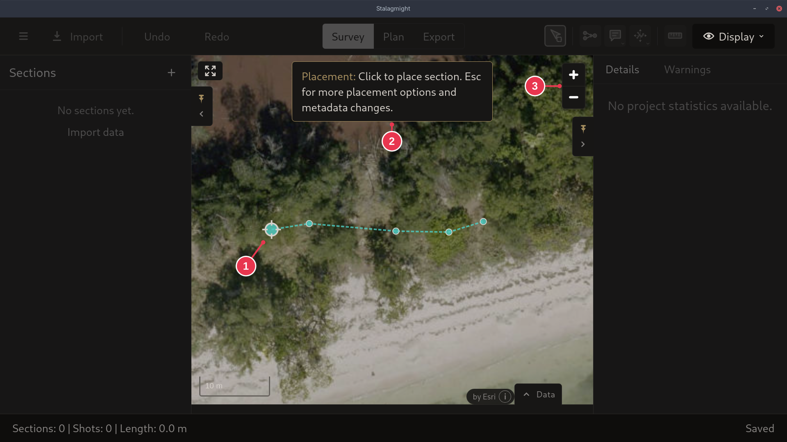

# Placement mode

After **Create Section**, the new section follows the pointer. Click the map to
drop it there.

It does not need to be accurate: the section can be moved later, or anchored to
a [zero datum](../concepts/sections-shots-stations.md).

1. The section's first station, under the pointer. It lands where you click.
2. **Esc** goes back to the dialog that started placement, with everything you
   entered. For a hand-entered section that is the
   [Import / Create Section dialog](create-section-dialog.md).
3. Zoom. The map can also be dragged and scrolled while placing.

## Details

- Pointing at an existing station snaps the section to it. Clicking then merges
  the two stations.
- The toolbar is disabled until the section is placed.
