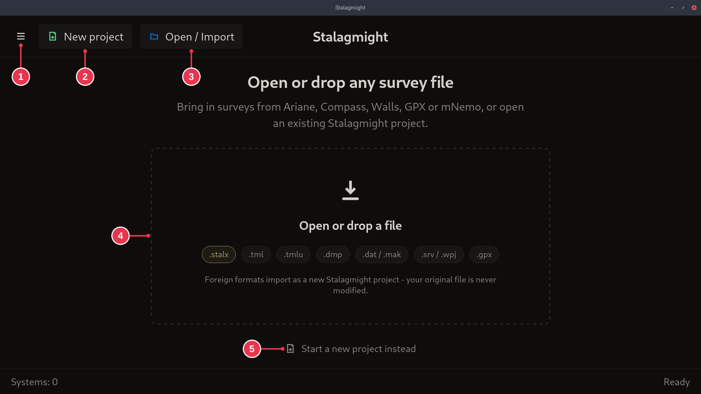

# Start screen

Shown at launch until you open a project. After that it lists recent projects.

1. **Menu**: **New project**, **Open / Import**, **Import from MNemo...**,
   **Settings**, **Debug** (holds **Debug Logs**), **Quit**.
2. **New project**: opens the [New Project dialog](new-project-dialog.md).
3. **Open / Import**: open a `.stalx` project or import another format, for
   example [an Ariane survey](../workflows/importing-from-ariane.md).
4. **Open or drop a file**: click it to do the same as 3, or drop a file
   anywhere on the window.
5. **Start a new project instead**: same as 2.

Above the drop area, on the right, is a **SpeleoDB** button (not in the
picture). It opens Settings on the SpeleoDB page to sign in. Signed in, it
becomes **Refresh SpeleoDB**.

## Details

- Formats: `.stalx` (Stalagmight), `.tml` / `.tmlu` (Ariane), `.dmp` (MNemo),
  `.dat` / `.mak` (Compass), `.srv` / `.wpj` (Walls), `.gpx` (GPX).
- An import creates a new project. The original file is not changed.
- **Import from MNemo...** reads the survey memory of an MNemo connected by
  USB, saves it as a `.dmp` file and imports that like any `.dmp`.
- Signed in to SpeleoDB, the menu (1) also has **Open from SpeleoDB**.
- With recent projects, the top bar gets **Map** and **List** to switch between
  a map of your projects and a list of them.
- `Systems: 0` is the number of recent projects.
- The very first launch may show an orientation and a usage-statistics question
  on top of this screen.
- On macOS the menu bar's **Help** menu has **Stalagmight Help** (this guide),
  **Keyboard Shortcuts** and **Report an Issue...**.
