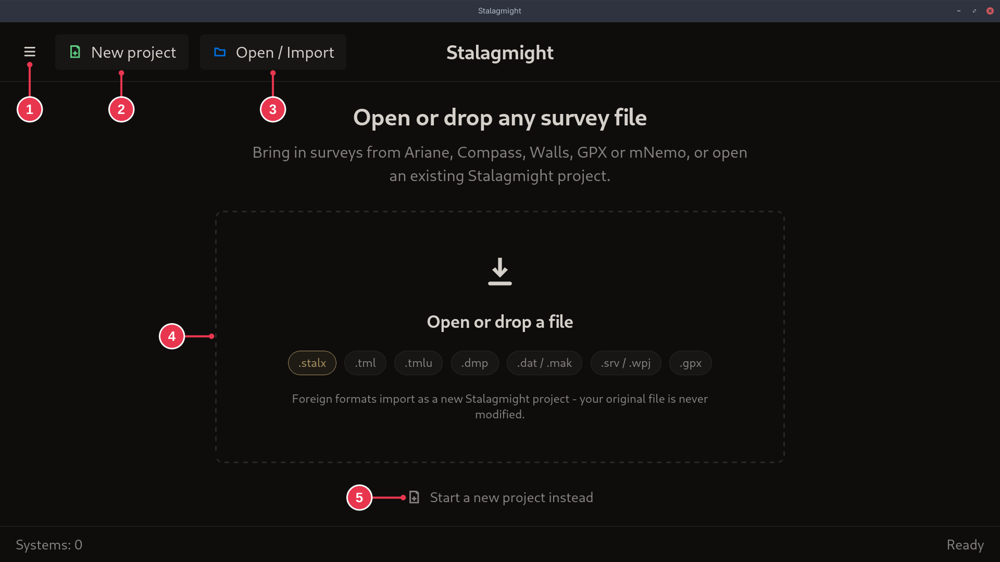

# Start screen

Shown at launch until you open a project. After that it lists recent projects.

1. **Menu**: New project, Open / Import, Settings, Debug (holds Debug Logs), Quit.
2. **New project**: opens the [New Project dialog](new-project-dialog.md).
3. **Open / Import**: open a `.stalx` project or import another format, for
   example [an Ariane survey](../workflows/importing-from-ariane.md).
4. **Drop area**: click it to do the same as 3, or drop a file anywhere on the
   window.
5. **Start a new project instead**: same as 2.

## Details

- Formats: `.stalx` (Stalagmight), `.tml` / `.tmlu` (Ariane), `.dmp` (mNemo),
  `.dat` / `.mak` (Compass), `.srv` / `.wpj` (Walls), `.gpx` (GPX).
- An import creates a new project. The original file is not changed.
- `Systems: 0` is the number of recent projects.
- Signed in to SpeleoDB, the menu (1) also has **Open from SpeleoDB**.
- The very first launch may show an orientation and a usage-statistics question
  on top of this screen.
