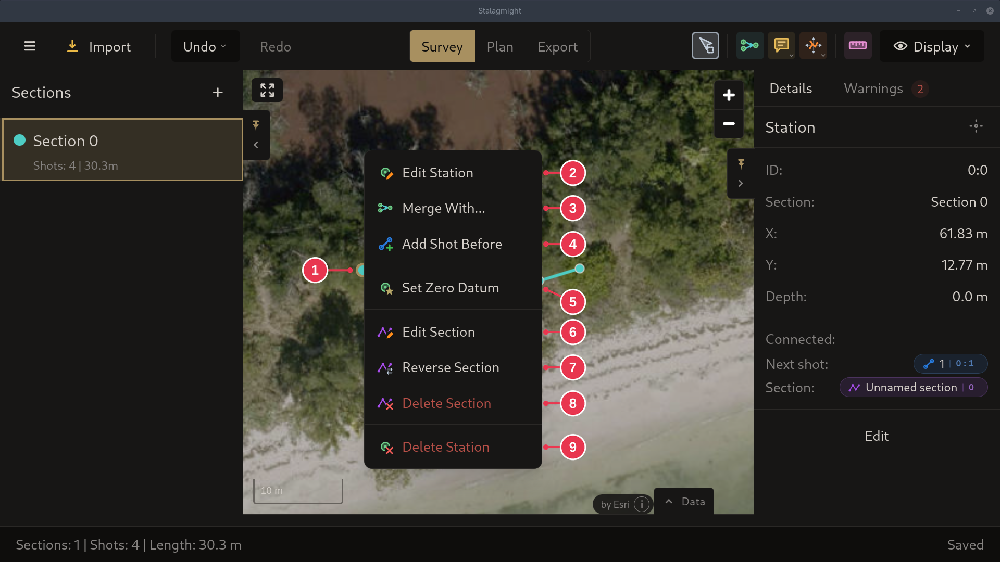

# Station context menu

Right-click a station on the map in Survey mode.

1. The station you right-clicked.
2. **Edit Station**: opens the [Edit Station dialog](edit-station-dialog.md).
3. **Merge With...**: then click the station to merge with. See
   [Merging stations](../workflows/merging-stations.md) and
   [Closing a loop](../workflows/closing-a-loop.md).
4. **Add Shot Before**: first station only. The last station has **Add Shot
   After** instead.
5. **Set Zero Datum**: tie this station to a GPS position. See
   [Setting a zero datum](../workflows/setting-a-zero-datum.md).
6. **Edit Line**
7. **Reverse Line**
8. **Delete Line**
9. **Delete Station**

The picture predates the combine and split entries. The menu now also has, just
above **Edit Line**:

- **Combine Lines...** (first or last station of a line): join two
  lines that meet end to end at this station. With exactly one other line
  ending there it reads **Combine Line With** and that line's name; with
  more, it opens a list of pairs. Under the label it says how the two meet, or
  why they cannot be combined (for example when no other line ends there).
- **Split Line Here** (any station between the first and the last): cut the
  line in two at this station.

See [Combining and splitting lines](../workflows/combining-and-splitting-sections.md).

## All entries

In menu order, with when each one shows:

| Entry | Shows |
|---|---|
| **Edit Station** | Always |
| **Merge With...** | Always |
| **Unmerge Stations** | Station is merged with another |
| **Remove Closure** | Station is on a loop closure |
| **Add Shot Before** | First station of the line |
| **Add Shot After** | Last station of the line |
| **Set Zero Datum** | Always |
| **Combine Lines...** | First or last station of the line |
| **Split Line Here** | Any other station |
| **Edit Line** | Always |
| **Reverse Line** | Always |
| **Reverse 2 Lines** (and so on) | Several lines selected, this one among them |
| **Delete Line** | Always |
| **Delete Station** | Always |

## Details

- **Unmerge Stations**: see
  [Unmerging stations](../workflows/merging-stations.md#unmerging-stations).
  **Remove Closure**: see
  [Removing a closure](../workflows/closing-a-loop.md#removing-a-closure).
- **Add Shot Before** and **Add Shot After** name the new station after the
  line's others: after `5` comes `6`, and before a line `0` to `6` comes `7`.
  **Insert Station...** in the shot menu puts a lettered station inside the
  shot: `4a` on `4 → 5`. See
  [Names for new stations](../concepts/sections-shots-stations.md#names-for-new-stations).
- In **Edit Line**, the line's name cannot be empty or the name of another
  line: the reason shows under the name, and the dialog does not save until
  it is fixed.
- Both deletes ask for confirmation first.
- In the Closures Computed View, or on a SpeleoDB project you are not editing,
  the entries are shown but disabled.
- Right-clicking a point along a shot gives the shot menu, which also has
  **Split Line Here**: the split is made at that point.
- In Plan mode a right-click on a station gives the route menu instead:
  **Set as start point**, **Set as way point**, **Set as endpoint**,
  **Set as stage drop** (on the planned route only; **Set as stage 1 drop**,
  **Set as stage 2 drop** and so on with several stages) and
  **Set marked point**.
  See [Planning a dive](../workflows/planning-a-dive.md). Export mode has no
  station menu.
