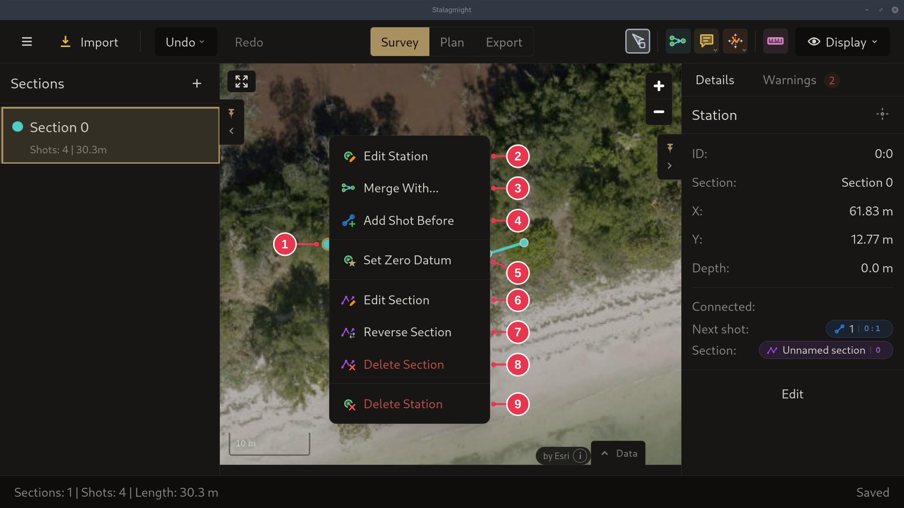

# Station context menu

Right-click a station on the map.

1. The station you right-clicked.
2. **Edit Station**: opens the [Edit Station dialog](edit-station-dialog.md).
3. **Merge With...**: then click the station to merge with. See
   [Merging stations](../workflows/merging-stations.md) and
   [Closing a loop](../workflows/closing-a-loop.md).
4. **Add Shot Before**: first station only. The last station has **Add Shot
   After** instead.
5. **Set Zero Datum**: tie this station to a GPS position. See
   [Setting a zero datum](../workflows/setting-a-zero-datum.md).
6. **Edit Section**
7. **Reverse Section**
8. **Delete Section**
9. **Delete Station**

## Details

- Merged stations also get **Unmerge Stations**, see
  [Unmerging stations](../workflows/merging-stations.md#unmerging-stations).
  Stations on a loop closure get
  **Remove Closure**, see [Removing a closure](../workflows/closing-a-loop.md#removing-a-closure).
- Both deletes ask for confirmation first.
