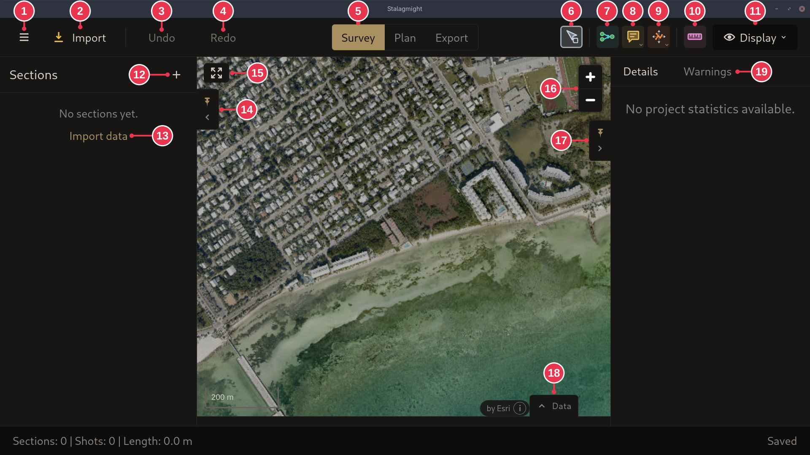

# Survey view

The main window of an open project: the map, with **Sections** (the list of
lines, grouped into sections) on the left, **Details** on the right and **Data**
at the bottom.

**Top bar**

1. **Menu**: see [the menu](#the-menu) below.
2. **Import**: add data from a `.dmp` file from an MNemo. See
   [DMP import](dmp-import.md).
3. **Undo** (`Ctrl+Z`)
4. **Redo** (`Ctrl+Y` or `Ctrl+Shift+Z`)
5. **Survey** / **Plan** / **Export**: edit the survey, plan a dive, or export
   a map. See [Plan and Export modes](#plan-and-export-modes).

**Tools**

6. **Select** (`S`)
7. **Merge** (`M`): merge two stations to connect lines. See
   [Merging stations](../workflows/merging-stations.md).
8. **Comment** (`C`): comment on a station or shot. See
   [Adding comments](../workflows/adding-comments.md).
9. **Move**: **Move segment** (`V`), **Move shot** (`G`) or **Move station**
   (`T`).
10. **Measure** (`R`): measure on the map.
11. **Display**: what the map shows. See the [Display menu](display-menu.md).

**Panels and map**

12. **Add line**: enter a new line by hand in the
    [Import / Create Line dialog](create-section-dialog.md).
13. **Import data**: same as 2.
14. Pin or hide the left panel.
15. **Fit to view**: zoom to the whole survey (`F`).
16. Zoom in / out (`=` or `+` / `-`).
17. Pin or hide the **Details** panel.
18. **Data**: tables of lines and raw shot data.
19. **Details**: project statistics or the selected item. **Warnings**: problems
    found in the data, see the [Warnings panel](warnings-panel.md).

The **Sections** panel also has **New Section**, left of **Add line** (not in
the picture). Once the project has a section, the panel lists each section
(color, name, number of lines and length, an eye to hide it on the map) with its
lines under it, then the **Ungrouped** lines. Drag lines onto a section, or
right-click one for **Move to Section**. See
[Grouping lines into sections](../workflows/grouping-lines-into-sections.md).

The left panel now has two tabs, **Sections** and **SpeleoDB**, where the
picture shows only the **Sections** heading. **SpeleoDB** shows a SpeleoDB
project's status and actions; for a local project it offers **Convert to a
SpeleoDB project**.

## Plan and Export modes

- **Plan**: plan a dive on the survey, with gas, route and stage drops. See
  [Planning a dive](../workflows/planning-a-dive.md).
- **Export**: make a map image or file of the survey. See
  [Exporting](../workflows/exporting.md).
- Both are read-only. **Import**, **Undo**, **Redo** and the editing tools are
  hidden there; **Select** and **Measure** stay. **Display** is in Survey and
  Plan only.

## The menu

- **New project** (`Ctrl+N`), **Open / Import** (`Ctrl+O`).
- **Save** (`Ctrl+S`), **Save As** (`Ctrl+Shift+S`; **Save a Copy** for a
  SpeleoDB project), **Save and Close**.
- **Import** (`Ctrl+I`), **Import from MNemo...** (an MNemo connected by USB),
  **Export** (`Ctrl+E`).
- **Local settings**, **Project Details** (project statistics in **Details**).
- **Settings**, **Debug**, **Close Project**, **Quit** (`Ctrl+Q`).

## Details

- The small arrow on 8 and 9 picks a variant: **Move comment** (`Shift+C`), or
  **Move segment** / **Move shot** / **Move station**.
- Hover over **Undo** or **Redo** to list recent steps; click one to undo or
  redo back to it.
- The map pans when you drag it and zooms with the scroll wheel, whatever the
  tool. **Pan** and **Zoom** tools can be added to the toolbar with **Show
  navigation tools** in Settings.
- In the Closures Computed View, or on a SpeleoDB project you are not editing,
  the editing tools and **Import** are disabled.
- An unpinned panel slides out when you hover its edge. `Ctrl+1`, `Ctrl+2` and
  `Ctrl+3` show or hide the left panel, **Details** and **Data**.
- Status bar: number of lines and shots, total length, save state.
- A project without data opens the map on the default location from Settings.
- Satellite imagery by Esri.
- Shortcuts can be changed in Settings. On macOS, use `Cmd` for `Ctrl`.
