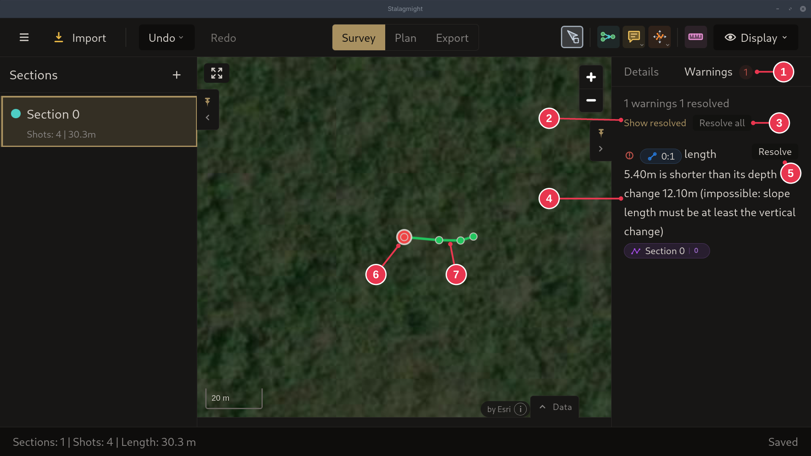
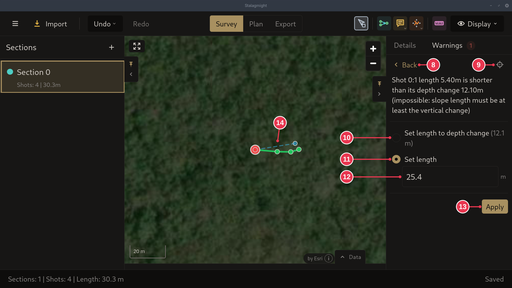

# Warnings panel

The **Warnings** tab of the right panel. It lists problems in the survey
geometry, whether from the survey itself or from data entry, split into
[errors and warnings](../concepts/errors-and-warnings.md). While it is open,
the map uses **Survey Issues** coloring and **Errors** labels: each shot is
graded from green (its readings agree) through yellow (at a warning threshold)
to red (three times the threshold, or an error), and labelled with how far its
readings disagree.

1. **Warnings**: the number is how many are still open.
2. **Show resolved**: also list the resolved ones.
3. **Resolve all**: go through every open warning in turn.
4. A warning. Click it to highlight the shot on the map, double-click to pan
   to it. The shot (`0:1`) and section pills open them in **Details**.
5. **Resolve**: pick a fix, see below.
6. Red: where the error is.
7. Green: no problem.

## Resolving

**Resolve** (5) replaces the list with the fixes that fit the problem.

8. **Back**: to the list, nothing changed.
9. **Zoom to the shot**
10. **Set length to depth change**: the shortest length that is physically
    possible.
11. **Set length**: type the right length. Better when the recorded one was a
    typo.
12. The new length.
13. **Apply**
14. Preview of the fixed shot on the map.

## Details

- The fixes depend on the problem. A shot shorter than its depth change can also
  get **Set length from inclination**, if it has an inclination.
- **Resolve all** (3) shows the same view with **Skip**, **Exit** and **Apply /
  Next**.
- Errors can only be fixed. Warnings can also be ignored with **Ignore (keep
  value, don't warn again)**.
- Two errors are about loop closures, not readings. A closure that ties
  together the two ends of one shot has no loop to close, and the Closures
  Computed View skips it: **Remove this loop closure** fixes it, **Go to
  closure station** shows it in **Details**. A part of the survey the Closures
  Computed View could not adjust is shown there as measured; the message says
  why, and **Go to station** takes you to it.
- Under **Show resolved**, resolved warnings are struck through. **Mark
  unresolved** brings one back.
- The map coloring and labels on this tab can be turned off in Settings:
  **Switching to warnings tab highlights issues on the map**.
- In the [Display menu](display-menu.md) you can pick another coloring or turn
  **Errors** off while the tab is open. That lasts until you leave the tab and is
  not saved.
