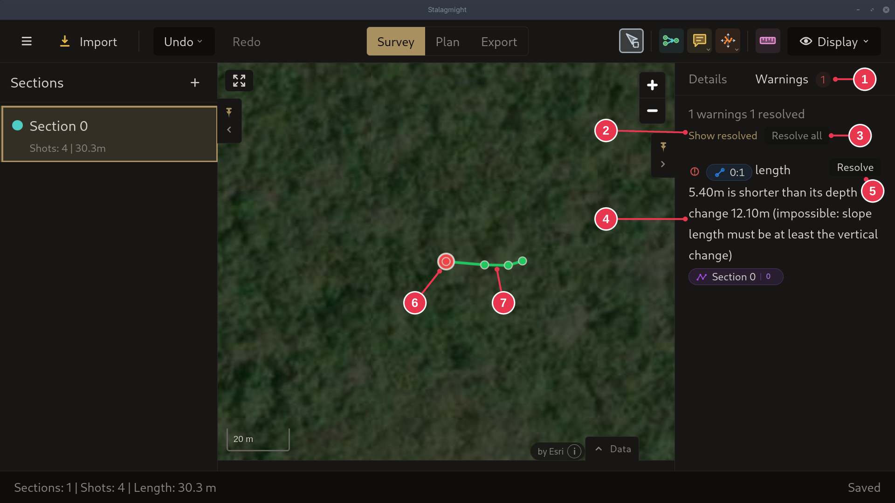
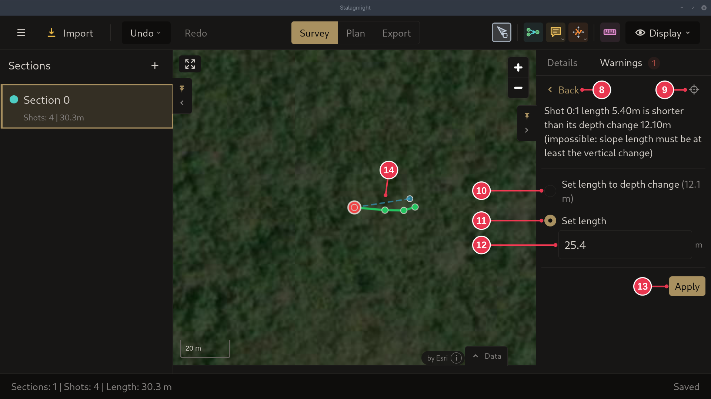

# Warnings panel

The **Warnings** tab of the right panel. It lists problems in the survey
geometry, whether from the survey itself or from data entry, split into
[errors and warnings](../concepts/errors-and-warnings.md). While it is open,
the map uses **Survey Issues** coloring and **Errors** labels: each shot is
graded from green (its readings agree) through yellow (at a warning threshold)
to red (three times the threshold, or an error), and labelled with how far its
readings disagree.

1. **Warnings**: the number is how many are still open.
2. **Show resolved**: also list the resolved ones.
3. **Resolve all**: go through every open warning in turn.
4. A warning. Click it to highlight the shot on the map, double-click to pan
   to it. The shot pill names the shot by its two stations, such as `0 → 1`,
   and the line pill shows the line's name; both open them in **Details**.
   The picture shows the older numbers (`0:1`, and the line's number beside
   its name).
5. **Resolve**: pick a fix, see below.
6. Red: where the error is.
7. Green: no problem.

## Resolving

**Resolve** (5) replaces the list with the fixes that fit the problem.

8. **Back**: to the list, nothing changed.
9. **Zoom to the shot**
10. **Set length to depth change**: the shortest length that is physically
    possible.
11. **Set length**: type the right length. Better when the recorded one was a
    typo.
12. The new length.
13. **Apply**
14. Preview of the fixed shot on the map.

## Details

- The fixes depend on the problem. A shot shorter than its depth change can also
  get **Set length from inclination**, if it has an inclination.
- **Resolve all** (3) shows the same view with **Skip**, **Exit** and **Apply /
  Next**.
- Errors can only be fixed. Warnings can also be ignored with **Ignore (keep
  value, don't warn again)**.
- Four entries are not about a shot's readings. They sit on a shot near the
  problem:
  - A [GPS fix](../concepts/zero-datums-and-gps-fixes.md) far from where the
    survey puts its station (a warning, listed on a shot next to the fix).
    The message gives the distance, its bearing and the limit. **Go to
    station** shows the fix in **Details**, **Edit zero datum** opens the
    [Edit Station dialog](edit-station-dialog.md) to correct its GPS, and it
    can be ignored. An ignored one comes back when the zero datum's GPS
    position changes; undoing that change ignores it again.
  - A loop closure that joins the two ends of one shot (an error). It would
    squeeze that shot to zero length, so the Closures Computed View skips it.
    **Remove this loop closure** fixes it (undoable), **Go to closure
    station** shows it in **Details**.
  - A part of the survey the Closures Computed View could not adjust, so it is
    shown there as measured (a warning, listed once that view, Plan or Export
    has been computed). The message says why, **Go to station** takes you to
    it, and it can be ignored.
  - A piece of the survey that nothing places: a line, or lines joined
    to it, with no zero datum and no connection to a part of the survey that
    has one (a warning, listed on the piece's first shot). It is listed only
    in a project with a zero datum. Merge a station onto the survey or give
    the piece a zero datum. **Go to station** shows it, and it can be ignored
    when the piece is meant to stay separate.
- **Edit zero datum** and **Remove this loop closure** are off where editing
  is off, for example in the Closures Computed View.
- **Show warnings** in a notice above the map opens this tab, see
  [Closing a loop](../workflows/closing-a-loop.md#notices-above-the-map).
- Under **Show resolved**, resolved warnings are struck through. **Mark
  unresolved** brings one back.
- The map coloring and labels on this tab can be turned off in Settings:
  **Switching to warnings tab highlights issues on the map**.
- In the [Display menu](display-menu.md) you can pick another coloring or turn
  **Errors** off while the tab is open. That lasts until you leave the tab and is
  not saved.
