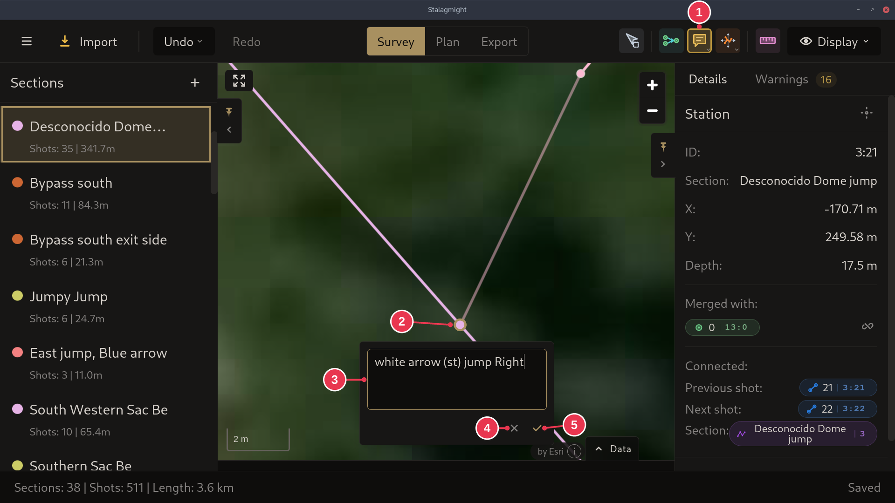

# Adding comments

1. In the [survey view](../screens/survey-view.md), pick **Comment** in the
   toolbar.
2. Click the station or shot to comment on.
3. Type the comment and press **Enter**.

## Step details

1. **Comment** is active.
2. The station clicked.
3. The comment. **Shift+Enter** starts a new line.
4. Cancel (also **Esc**).
5. Save (also **Enter**, or clicking anywhere else).

### Details

- Clicking a station or shot that already has a comment opens it for editing.
  Clearing the text removes the comment.
- The [Display menu](../screens/display-menu.md) has **Station comments** and
  **Shot comments** to show them on the map.
- The small arrow on **Comment** switches to **Move comment**.
