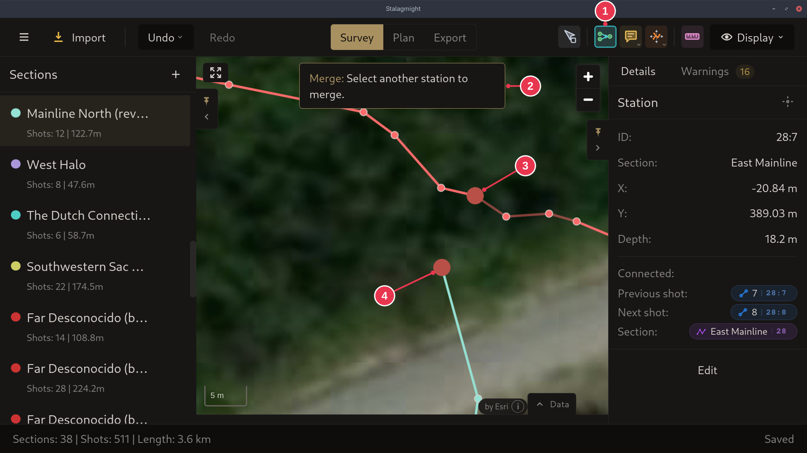
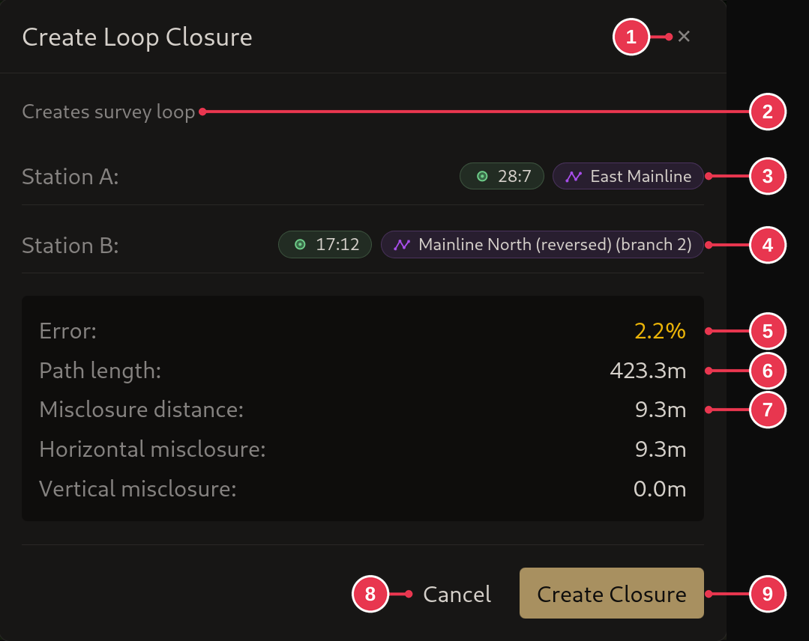
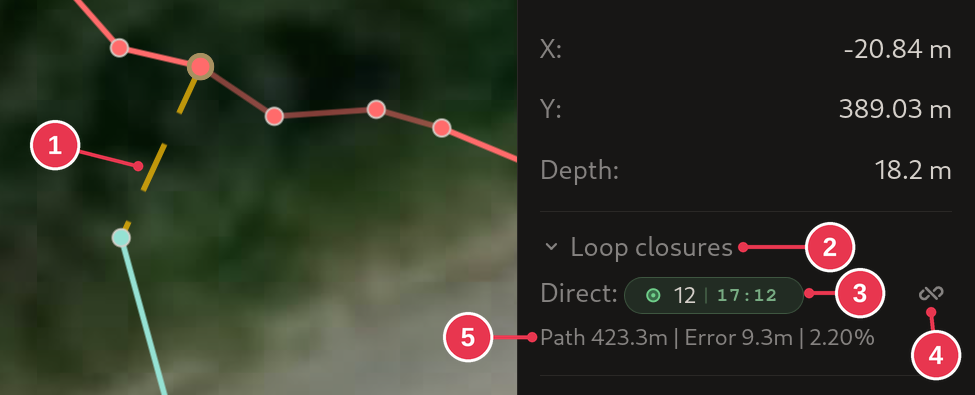
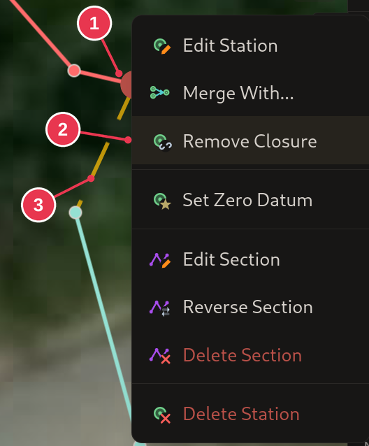

# Closing a loop

Use the **Merge** tool on two stations whose lines are already connected:
on one line, or joined through other merges and loop closures. Merging them
would make a loop, so Stalagmight offers a
[loop closure](../concepts/sections-shots-stations.md) instead.

1. In the [survey view](../screens/survey-view.md), pick **Merge** (`M`).
2. Click the first station, then the second.
3. Check the stations and the error in the
   [Create Loop Closure dialog](../screens/closure-dialog.md) and click **Create
   Closure**.

Right-clicking the first station and picking **Merge With...** does steps 1 and
2 up to the second click. See the
[station context menu](../screens/station-context-menu.md).

The closure shows as a dashed line. The survey itself does not move. To see it
adjusted to its closures, switch to **Plan**, or pick **Closures Computed View**
in the [Display menu](../screens/display-menu.md).

The two stations must not be the two ends of one shot: closing there would
squeeze that shot to zero length. The dialog says so and **Create Closure**
stays off, even when another passage also joins them. Pick other stations.

## Step details

### 1-2. Pick both stations

- **Merge** (1) is active, as for [merging stations](merging-stations.md).
- The first station (3) is picked. Click the second (4).

### 3. Create the closure

- The two stations (3, 4) and the error (5): here the survey misses by 9.3 m
  (7) over 423.3 m (6), 2.2%.
- **Create Closure** (9).

### The closure

1. The closure, a dashed line between the two stations. Nothing moved.
2. **Loop closures** in **Details**, for the selected station.
3. The station it closes to.
4. **Remove Closure**
5. Path length and error of the loop.

## Removing a closure

Right-click a station of the closure and pick **Remove Closure**. **Remove
Closure** in **Details** (4 above) does the same.

1. A station of the closure, right-clicked.
2. **Remove Closure**
3. The closure.

A station with more than one closure asks which one to remove.

## Notices above the map

While the map shows the **Closures Computed View**, a notice at the top left
of the map says when that view is not the whole story. **Show warnings**
opens the [Warnings panel](../screens/warnings-panel.md), which lists each case
with its fix.

- "1 loop closure skipped: it spans a single shot." A project from an older
  version, or a file you add, can still have a closure across one shot. The
  view leaves it out and adjusts the rest of the survey. The Warnings panel
  lists it as an error with **Remove this loop closure** (switch to the **Raw
  Data View** first: editing is off in the Closures Computed View).
- "Part of the survey could not be adjusted and is shown as measured." For
  example, loop closures tie two zero datums to the same point. The warning in
  the Warnings panel says which part and why.
- "Bent to a GPS fix at 2:14, 32 m from its surveyed position. Check it." The
  view passes through a [GPS fix](../concepts/zero-datums-and-gps-fixes.md)
  that is far from where the survey puts its station. Check the GPS reading and
  the survey. The notice stays while the fix is that far, even if you ignore
  its warning.

## Edits that remove a closure

Some edits would leave a closure that closes nothing. They remove it instead:

- Deleting shots with shift removes a closure the delete shortens to a single
  shot. The **Delete Shots** dialog lists it before you confirm.
- [Combining lines](combining-and-splitting-sections.md) removes a tie that
  would join the two ends of one shot, and splitting a line removes a
  closure whose two stations become one point. Their dialogs list it before
  you confirm.
- Deleting a shot or a line, unmerging, removing a zero datum and merging
  two placed pieces remove a closure whose two stations become one point.

A warning names each removed closure afterwards, and one **Undo** brings it
back with the rest of the edit.

An older project in which a merge had been pulled apart between two pieces,
each placed by its own zero datum, opens with that merge as a loop closure.
Nothing moves. To join the two pieces, [merge](merging-stations.md) the
stations again.
