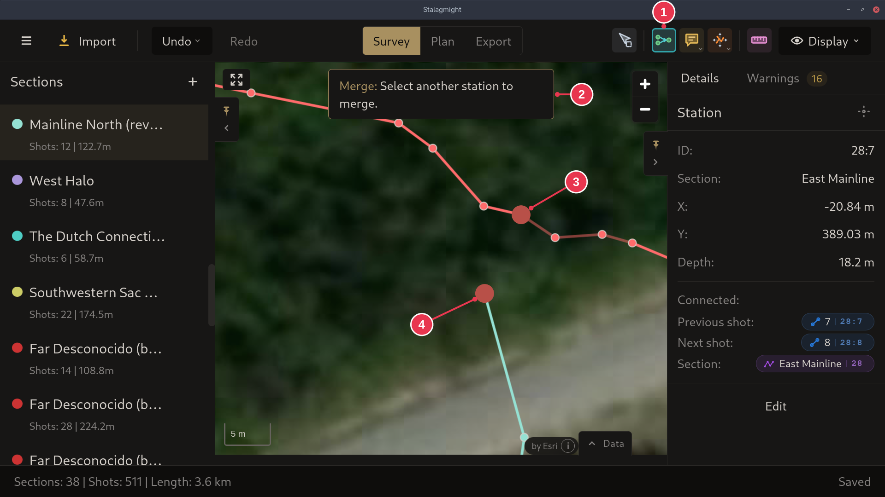
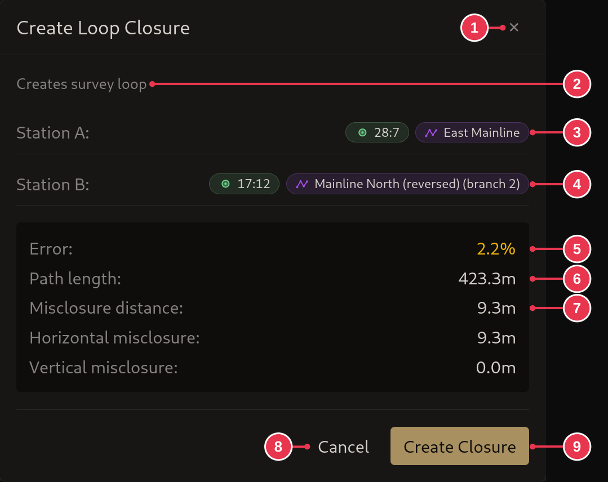
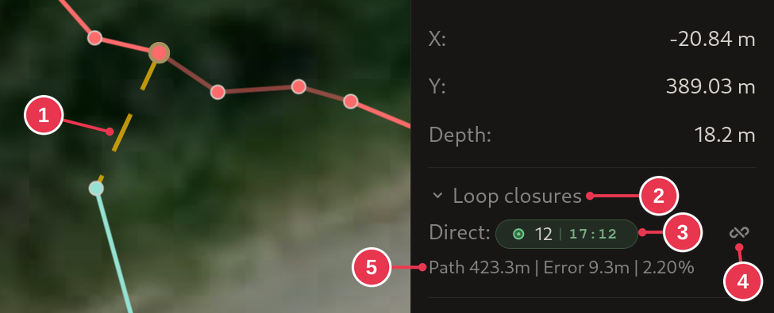
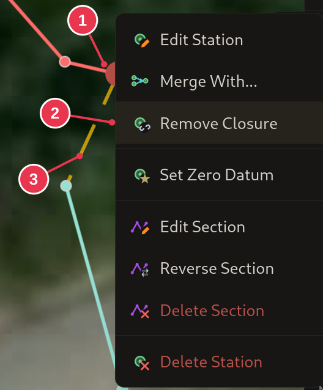

# Closing a loop

Use the **Merge** tool on two stations that cannot be merged: their sections
are already connected another way, or both are fixed by a
[zero datum](../concepts/sections-shots-stations.md). Stalagmight then creates a
[loop closure](../concepts/sections-shots-stations.md) instead.

1. In the [survey view](../screens/survey-view.md), pick **Merge** (`M`).
2. Click the first station, then the second.
3. Check the stations and the error in the
   [Create Loop Closure dialog](../screens/closure-dialog.md) and click **Create
   Closure**.

Right-clicking the first station and picking **Merge With...** does steps 1 and
2 up to the second click. See the
[station context menu](../screens/station-context-menu.md).

The closure shows as a dashed line. The survey itself does not move. To see it
adjusted to its closures, switch to **Plan**, or pick **Closures Computed View**
in the [Display menu](../screens/display-menu.md).

## Step details

### 1-2. Pick both stations

- **Merge** (1) is active, as for [merging stations](merging-stations.md).
- The first station (3) is picked. Click the second (4).

### 3. Create the closure

- The two stations (3, 4) and the error (5): here the survey misses by 9.3 m
  (7) over 423.3 m (6), 2.2%.
- **Create Closure** (9).

### The closure

1. The closure, a dashed line between the two stations. Nothing moved.
2. **Loop closures** in **Details**, for the selected station.
3. The station it closes to.
4. **Remove Closure**
5. Path length and error of the loop.

## Removing a closure

Right-click a station of the closure and pick **Remove Closure**. **Remove
Closure** in **Details** (4 above) does the same.

1. A station of the closure, right-clicked.
2. **Remove Closure**
3. The closure.

A station with more than one closure asks which one to remove.
