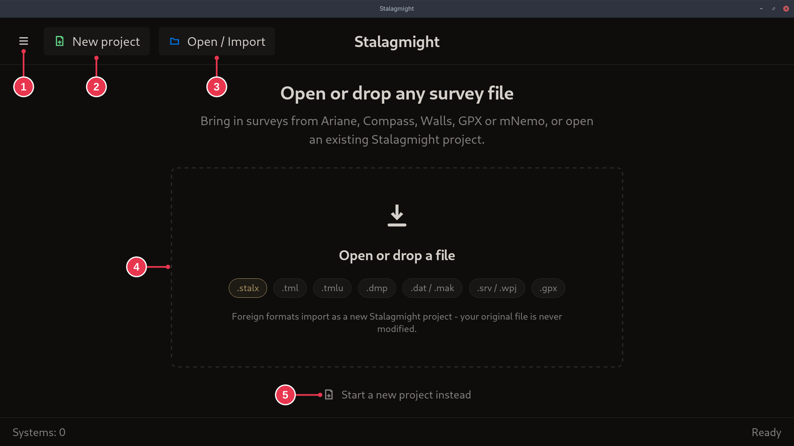
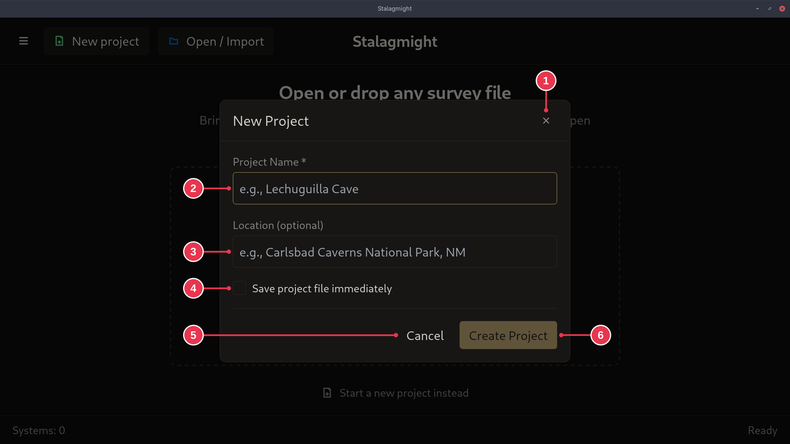
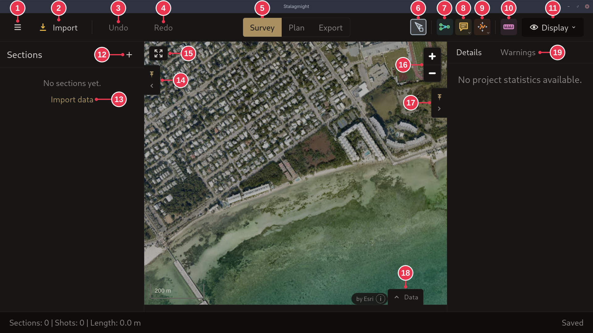
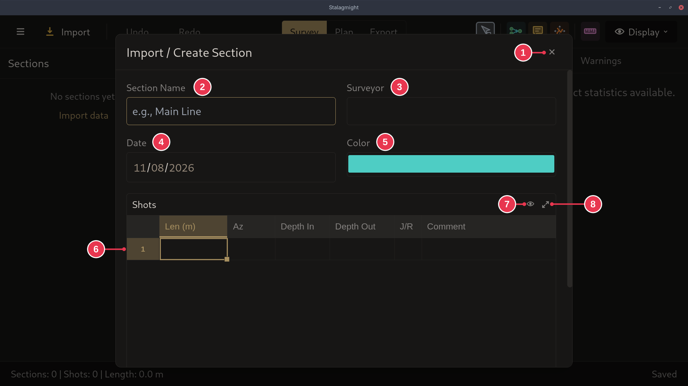
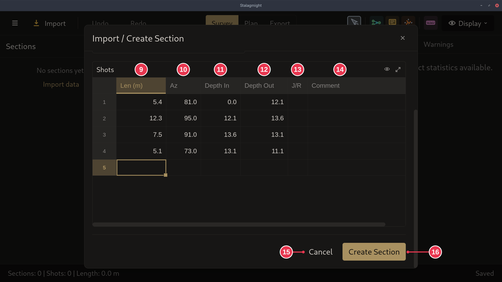
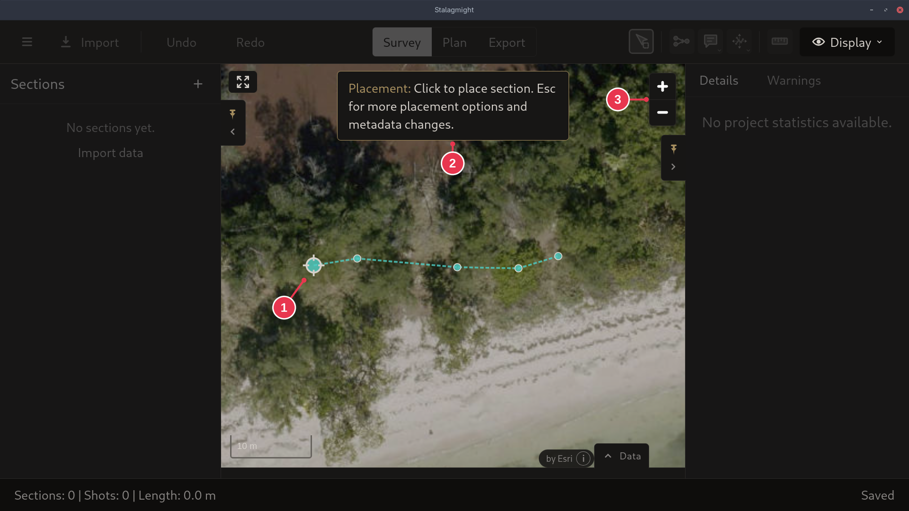

# Creating a new survey

1. On the [start screen](../screens/start-screen.md), click **New project**.
2. In the [New Project dialog](../screens/new-project-dialog.md), enter a name
   and click **Create Project**.
3. In the [survey view](../screens/survey-view.md), add data:
   [import a file](importing-from-mnemo.md) (for example a `.dmp` from an
   MNemo), or click **+** next to **Sections** to enter it by hand.
4. Entering by hand: in the
   [Import / Create Section dialog](../screens/create-section-dialog.md), name
   the section and set the surveyor, date and color.
5. Enter one row per shot and click **Create Section**.
6. Click the map to [place the section](../screens/placement-mode.md). Rough
   is fine, it can be moved later.
7. Optional: [set a zero datum](setting-a-zero-datum.md) to put the survey at
   its real GPS position.
8. Check the **Warnings** tab and [fix what it finds](fixing-warnings.md).

Tick **Save project file immediately** to create the file right away. Otherwise
it is saved once you add data.

Already have the survey in another program? Use **Open / Import** on the start
screen instead.

## Step details

### 1. New project

Click **New project** (2) or **Start a new project instead** (5). A dialog asks
for the project details.

### 2. Project details

- **Project Name** (2) is required. **Location** (3) is optional.
- **Save project file immediately** (4): ticked, the `.stalx` file is created
  as soon as the project opens. Unticked, it is saved only once you add data.
- **Create Project** (6) opens the new project.

### 3. Add data

- **Import** (2) or **Import data** (13): read data from a file, for example a
  `.dmp` from an MNemo.
- **Add section** (12): start an empty section and enter shots by hand. See
  [Sections, shots and stations](../concepts/sections-shots-stations.md).

### 4. Section details

- **Section Name** (2), **Surveyor** (3) and **Date** (4, when the line was
  surveyed) are optional.
- **Color** (5) is how the section shows on the map.

### 5. Shots

- Per shot: **Len** (9), **Az** (10), **Depth In** (11), **Depth Out** (12).
- **J/R** (13): leave blank for permanent line. Click it for `J` (jump) or `R`
  (reference). See
  [shot kinds](../concepts/sections-shots-stations.md).
- **Create Section** (16).
- LRUD, and azimuth or inclination at both ends of a shot, are extra columns
  under the eye icon. See the
  [dialog page](../screens/create-section-dialog.md).

### 6. Place the section

- The first station (1) follows the pointer. Click to drop the section.
- Drag, scroll or zoom (3) the map to get to the right spot.
- Placement does not need to be accurate. The section can be moved later or
  anchored to a [zero datum](../concepts/sections-shots-stations.md).
- **Esc** (2) goes back to the dialog with what you entered.
