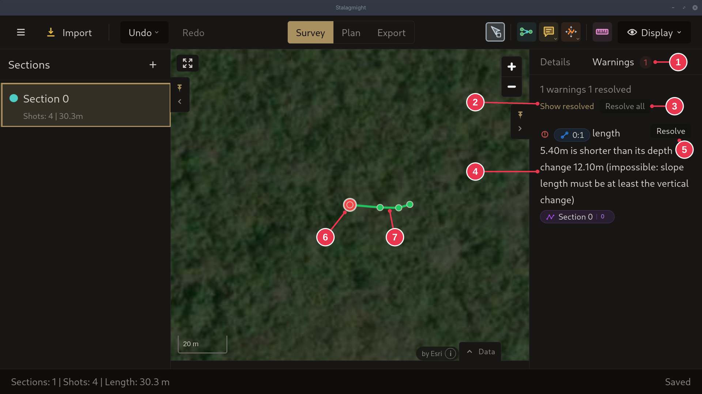
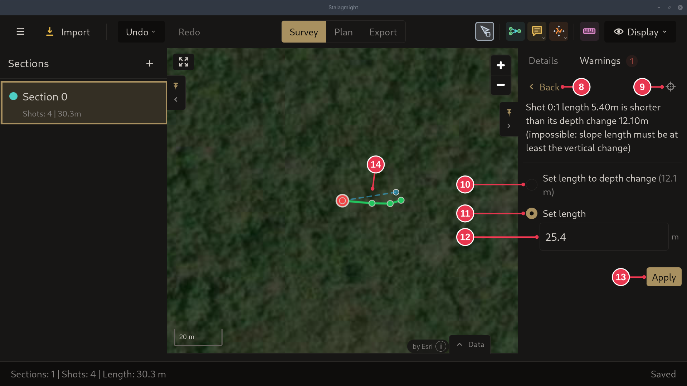

# Fixing warnings

1. Open the **Warnings** tab in the [survey view](../screens/survey-view.md).
   Red on the map is an error, yellow a warning.
2. Click **Resolve** on a warning, pick a fix, check the preview on the map and
   click **Apply**.

Always fix errors. A warning may just mean the shot needs retaking, see
[Errors and warnings](../concepts/errors-and-warnings.md).

## Step details

### 1. Warnings tab

- Here the first shot is shorter than its depth change (4), which is
  impossible. Its station is red on the map (6).
- **Resolve** (5) fixes one warning, **Resolve all** (3) goes through all of
  them. See the [Warnings panel](../screens/warnings-panel.md).

### 2. Pick a fix

- **Set length to depth change** (10): the shortest length that is physically
  possible.
- **Set length** (11): type the right value (12). Better when the recorded
  length was a typo, like 5.4 for 25.4 here.
- The dashed line (14) previews the fixed shot.
- **Apply** (13).

The fixes depend on the problem. Inclination in and out too far apart offers
**Use inclination in**, **Use inclination out**, **Average** (the default) or
**Set inclination**.

Some entries are not about a shot's readings:

- A GPS fix far from where the survey puts its station: check the GPS reading
  and the survey between the zero datums. **Edit zero datum** corrects the GPS
  in the [Edit Station dialog](../screens/edit-station-dialog.md), **Go to
  station** shows the fix, and **Ignore (keep value, don't warn again)** keeps
  it when the gap is real. The warning comes back if the GPS position changes.
- A loop closure across a single shot (an error): **Remove this loop closure**.
- A part of the survey the Closures Computed View could not adjust (a warning):
  **Go to station**, then fix the closures or zero datums the message names, or
  ignore it.
- A piece of the survey that nothing places, with no zero datum and no
  connection to a part that has one (a warning): merge a station onto the
  survey or give the piece a zero datum, or ignore it when the piece is meant
  to stay separate. See the [Warnings panel](../screens/warnings-panel.md).

Switch back to the **Raw Data View** before **Edit zero datum** or **Remove
this loop closure**: editing is off in the Closures Computed View. See
[Zero datums and GPS fixes](../concepts/zero-datums-and-gps-fixes.md).
