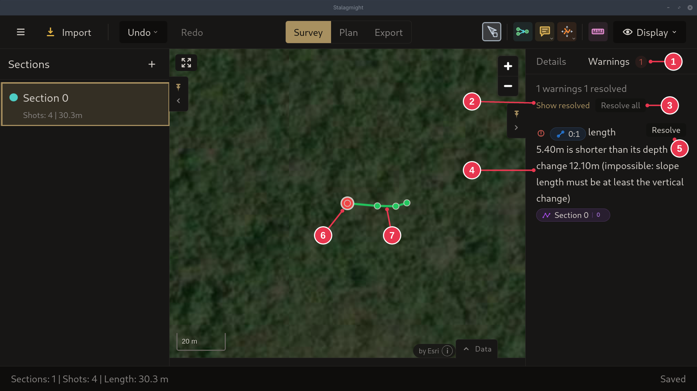
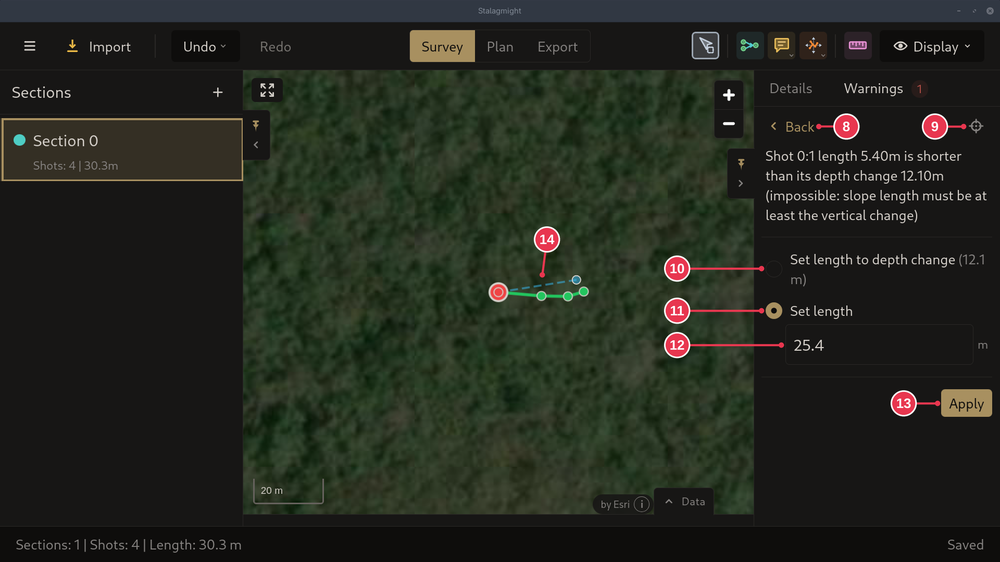

# Fixing warnings

1. Open the **Warnings** tab in the [survey view](../screens/survey-view.md).
   Red on the map is an error, yellow a warning.
2. Click **Resolve** on a warning, pick a fix, check the preview on the map and
   click **Apply**.

Always fix errors. A warning may just mean the shot needs retaking, see
[Errors and warnings](../concepts/errors-and-warnings.md).

## Step details

### 1. Warnings tab

- Here the first shot is shorter than its depth change (4), which is
  impossible. Its station is red on the map (6).
- **Resolve** (5) fixes one warning, **Resolve all** (3) goes through all of
  them. See the [Warnings panel](../screens/warnings-panel.md).

### 2. Pick a fix

- **Set length to depth change** (10): the shortest length that is physically
  possible.
- **Set length** (11): type the right value (12). Better when the recorded
  length was a typo, like 5.4 for 25.4 here.
- The dashed line (14) previews the fixed shot.
- **Apply** (13).

The fixes depend on the problem. Inclination in and out too far apart offers
**Use inclination in**, **Use inclination out**, **Average** (the default) or
**Set inclination**. A loop closure across a single shot offers **Remove this
loop closure** (switch back to the **Raw Data View** first: editing is off in the
Closures Computed View). A part of the survey the Closures Computed View could
not adjust is a warning, not an error: it offers **Go to station** and can be
ignored.
