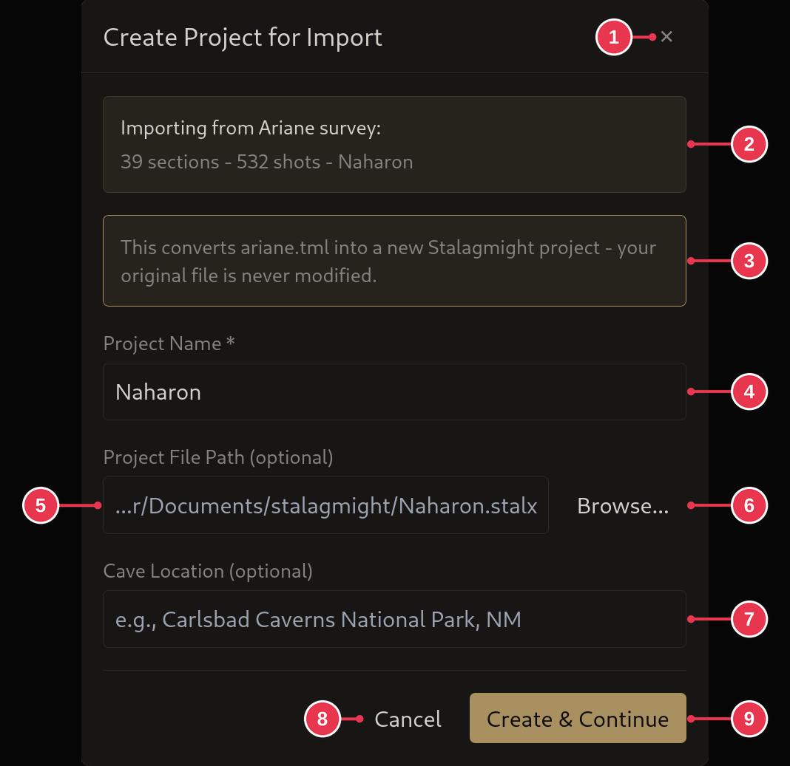
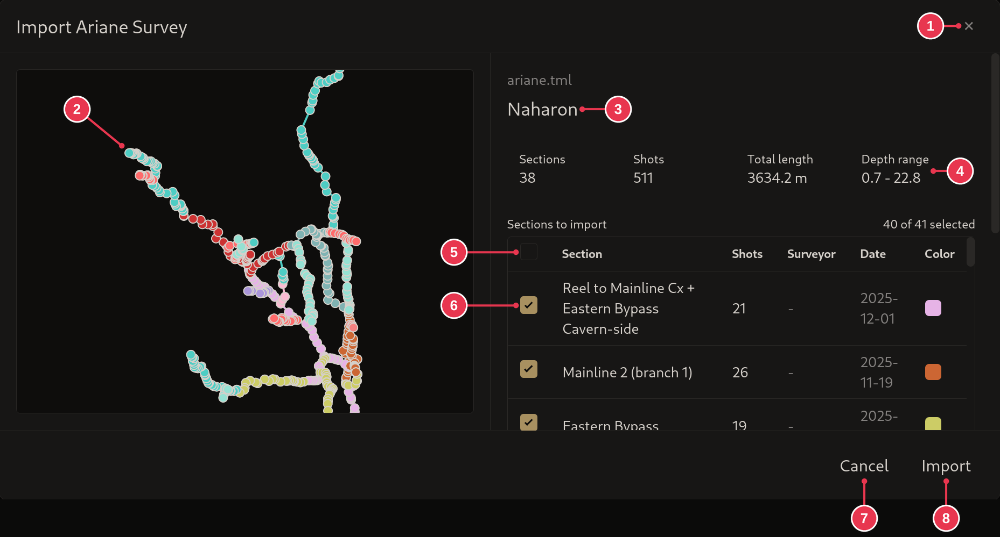
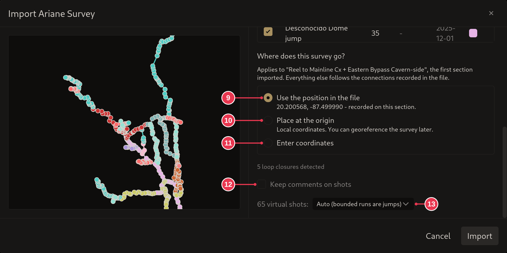
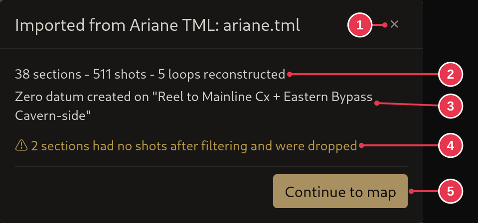

# Importing an Ariane survey

1. On the [start screen](../screens/start-screen.md), click **Open / Import**
   and pick the `.tml` or `.tmlu` file, or drop it onto the window.
2. Name the project and click **Create & Continue**. Where it is saved and the
   cave location are optional.
3. Untick any sections you do not want. Scroll down to check where the survey
   goes and the other options, then click **Import**.
4. Read the [import report](../screens/import-report.md) and click **Continue
   to map**. Then [check the warnings](fixing-warnings.md).

## Step details

### 2. Create the project

- **Project Name** (4) starts as the cave name in the file, or the file name.
- **Project File Path** (5): leave empty for the default, or **Browse...** (6).
- **Create & Continue** (9).
- See [Create Project for Import](../screens/create-project-for-import.md).

### 3. Pick sections

- The outline (2) and the numbers (4) show what will be imported.
- Untick sections (6) to leave them out.

- The survey is placed at the zero datum in the file (9) unless you pick
  otherwise.
- Comments go on stations, as Ariane shows them, unless you tick 12.
- Virtual shots (13) become jumps or references by Stalagmight's best guess.
- See [Import Ariane Survey](../screens/ariane-import.md) for what each option
  does.

### 4. Import report

- What was imported (2) and where the zero datum went (3).
- Warnings (4): here two sections had no shots left and were dropped.
- **Continue to map** (5).
