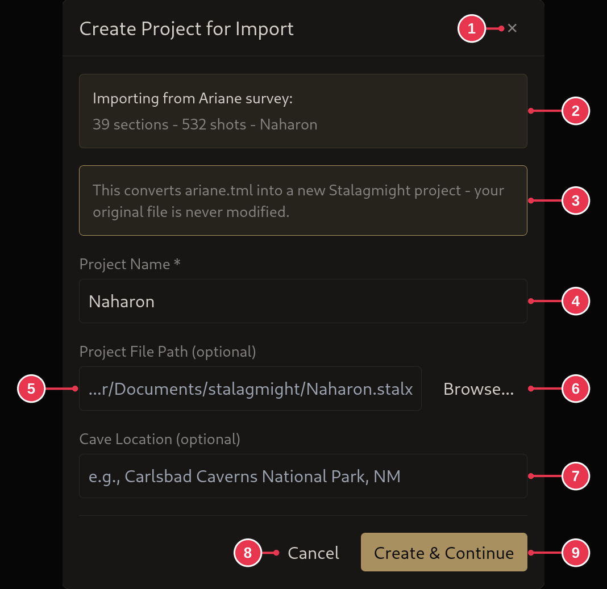
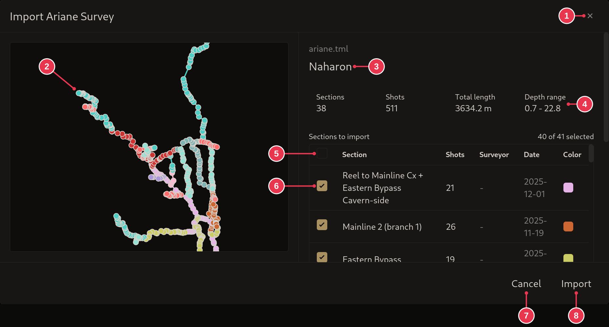
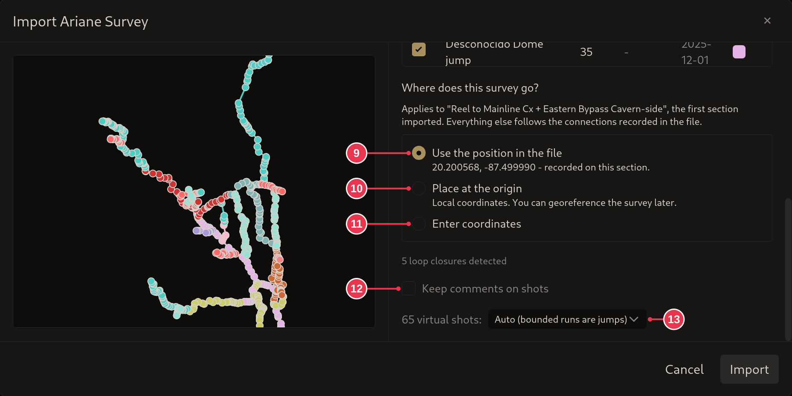
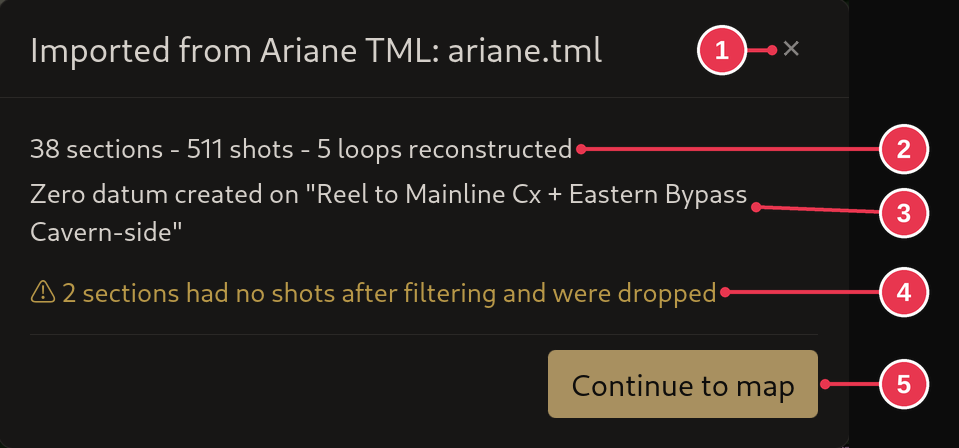

# Importing an Ariane survey

1. On the [start screen](../screens/start-screen.md), click **Open / Import**
   and pick the `.tml` or `.tmlu` file, or drop it onto the window.
2. Name the project and click **Create & Continue**. Where it is saved and the
   cave location are optional.
3. Untick any lines you do not want. Scroll down to check where the survey
   goes and the other options, then click **Import**.
4. If **Connect Orphaned Lines** opens, accept or skip each suggested
   connection.
5. Read the [import report](../screens/import-report.md) and click **Continue
   to map**. Then [check the warnings](fixing-warnings.md).

## Step details

### 1. Open the file

- An Ariane file always becomes a new project. With a project open, you are
  asked first: **Close and import** closes it.

### 2. Create the project

- **Project Name** (4) starts as the cave name in the file, or the file name.
- **Project File Path** (5): leave empty for the default, or **Browse...** (6).
- **Create & Continue** (9).
- See [Create Project for Import](../screens/create-project-for-import.md).

### 3. Pick lines

- The outline (2) and the numbers (4) show what will be imported.
- Untick lines (6) to leave them out. The rows also show each line's
  **Surveyors** and **Explorers**, as read from the file.

- The survey is placed at the GPS position in the file (9) unless you pick
  otherwise. This is the first zero datum of the project.
- A line that starts at another GPS-tagged entrance gets its own zero datum
  there. See
  [where each line goes](../screens/ariane-import.md#where-each-line-goes).
- Comments go on stations, as Ariane shows them, unless you tick 12.
- Virtual shots (13) become jumps or references by Stalagmight's best guess.
- See [Import Ariane Survey](../screens/ariane-import.md) for what each option
  does.

### 5. Import report

- What was imported (2) and where the zero datum went (3).
- Warnings (4): here two lines had no shots left and were dropped.
- **Continue to map** (5).
