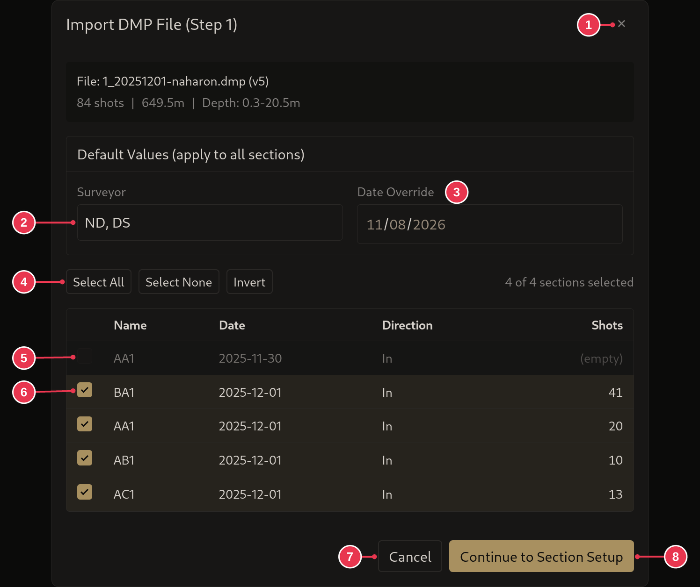
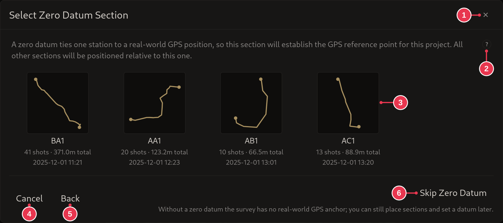
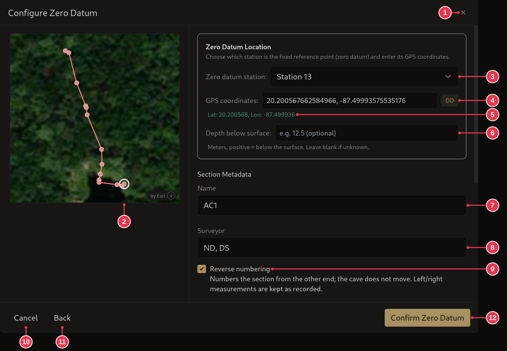
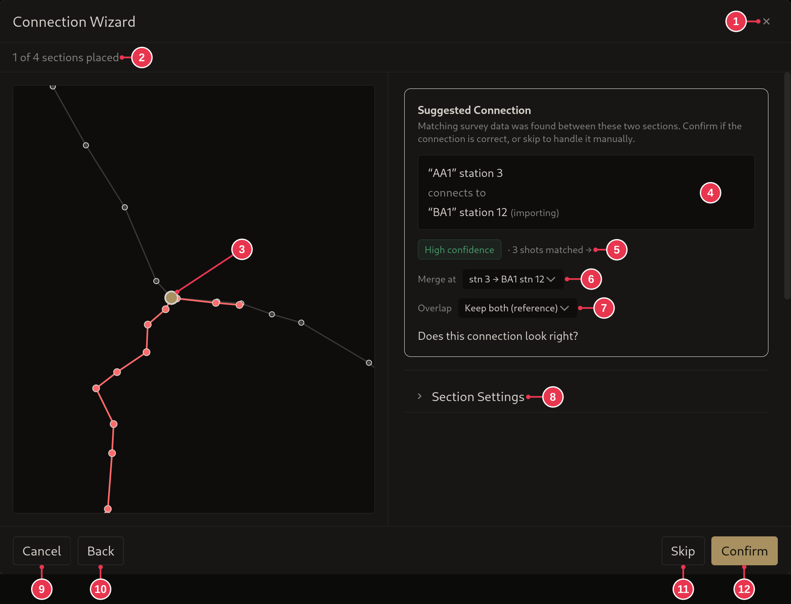
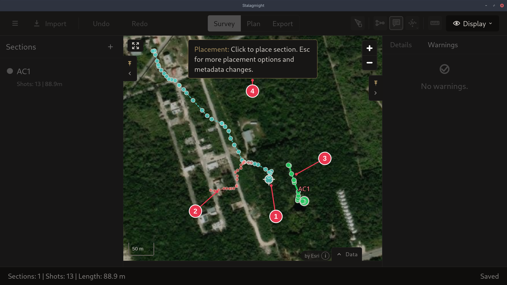
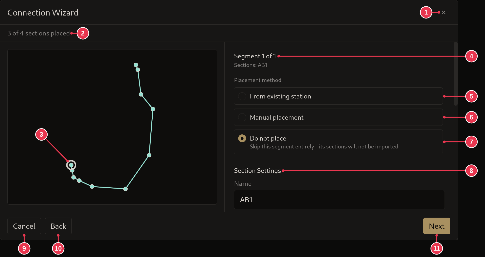

# Importing from an MNemo

1. In the [survey view](../screens/survey-view.md), click **Import** and pick
   the `.dmp` file.
2. Tick the sections to import and click **Continue to Section Setup**. Empty
   and already imported sections are left out for you.
3. Optional: click the section that should carry the
   [zero datum](../concepts/sections-shots-stations.md), or **Skip Zero
   Datum** and [set it later](setting-a-zero-datum.md).
4. If you picked one: choose its station, enter the GPS position and click
   **Confirm Zero Datum**.
5. For each suggested connection: check it on the preview and click
   **Confirm**, or **Skip** to place that section by hand later.
6. Sections left over: click the map to drop them roughly where they belong.
   Connect them later, once the data is there.
7. A section that does not belong to this survey: press **Esc**, pick **Do
   not place** and click **Next**.
8. If an [import report](../screens/import-report.md) opens, read it and click
   **Continue to map**.

## Step details

### 2. Pick sections

- Ticked sections (6) are imported. Empty ones (5) can't be picked.
- **Surveyor** (2) and **Date Override** (3) apply to every section.
- See [DMP import](../screens/dmp-import.md).

### 3. Zero datum

- Only asked when the project has no zero datum yet.
- Click the section's card, AC1 here (3).
- **Skip Zero Datum** (6) imports without one.

### 4. Zero datum station and position

- **Zero datum station** (3): station 13 here. Clicking a station on the
  preview (2) picks it too.
- **GPS coordinates** (4), in any
  [GPS format](../screens/edit-station-dialog.md#gps-formats). Check what it
  read (5).
- Optional: scroll down to check or change the shots (16). This can also be
  done later. See [DMP import](../screens/dmp-import.md).
- **Confirm Zero Datum** (12) continues the import.

### 5. Suggested connections

- Stalagmight found where this section joins from matching reference shots.
  Here there is one high-confidence match (5), and it is right.
- Check the join on the preview (3): the gold dot is the shared station.
- **Confirm** (12) if it is right. Otherwise **Skip** (11) and place the
  section by hand later.
- Scroll down to view or edit the shots. This can also be done later.

### 6. Place the rest by hand

- Here the dashed sections (2) are not connected to the survey yet: the data to
  join them is not there.
- Click the map to drop them. The station under the pointer (1) lands where you
  click.
- It does not need to be accurate. They can be moved, or connected, later.

### 7. Leave a section out

- Here AB1 turned out not to be part of this survey.
- **Esc** during placement opens these options. Pick **Do not place** (7) and
  click **Next** (11).
- See [DMP import](../screens/dmp-import.md#step-6-other-placement-options) for
  the other options.
