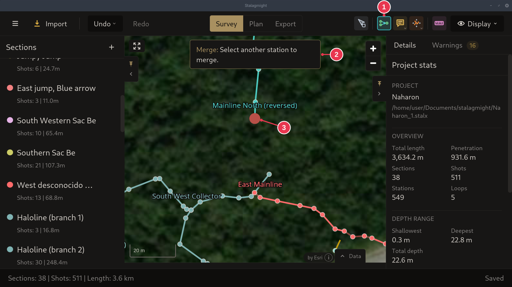
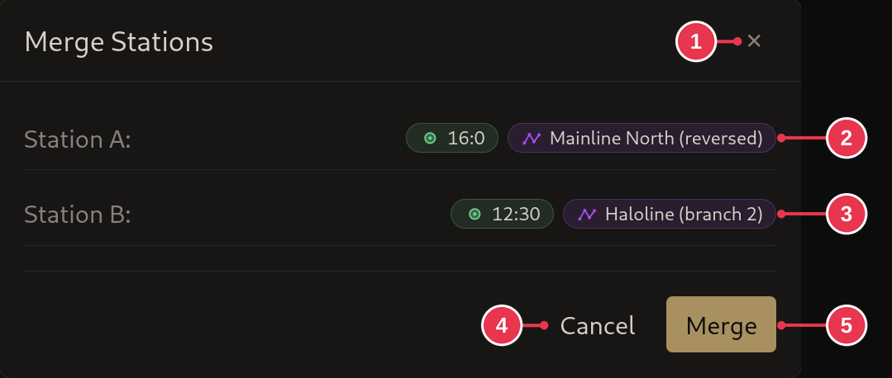
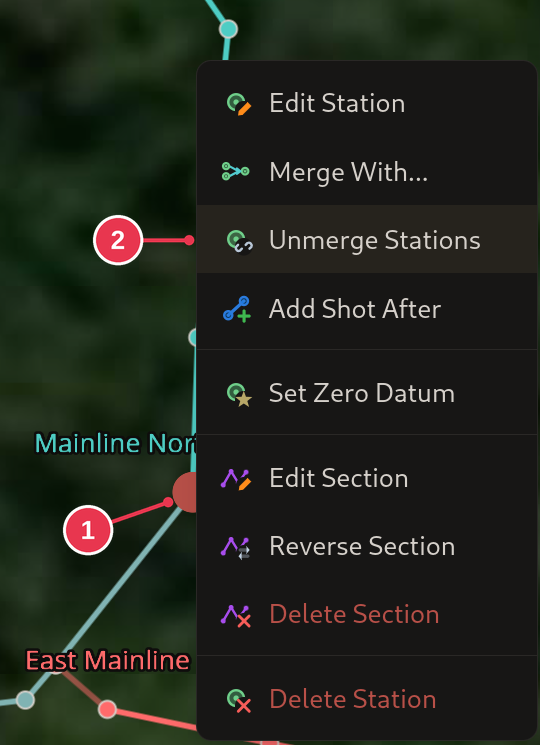

# Merging stations

Joins two lines at a shared station. Useful when a line could not be
placed from reference shots and was placed by hand, or to join two parts of a
cave that each have their own GPS position.

1. In the [survey view](../screens/survey-view.md), pick **Merge** (`M`) in the
   toolbar.
2. Click the station to merge.
3. Click the station to merge it to.
4. Check the two stations in the [Merge Stations dialog](../screens/merge-stations-dialog.md)
   and click **Merge**.

Right-clicking a station and picking **Merge With...** does steps 1 and 2 in one
go. See the [station context menu](../screens/station-context-menu.md).

## Step details

### 1-2. Merge tool and first station

- **Merge** (1) is active.
- The first station (3) is picked. The banner (2) asks for the second.

### 3-4. Second station and confirm

- **Station A** (2) is the first station clicked, **Station B** (3) the second.
  The dialog now offers them as **Keep** choices: the kept station is shown on
  every line, the other is archived (see the
  [Merge Stations dialog](../screens/merge-stations-dialog.md)).
- **Merge** (5). The first station's line moves onto the second, unless a
  zero datum holds it in place.

### Details

- After the second click, Stalagmight checks that the merge is possible. If the
  two lines are already connected, on one line or through other merges
  and closures, it offers a [loop closure](closing-a-loop.md) instead. If the
  stations are already merged or already joined by a loop closure, a
  notification says so.
- Two pieces that each have their own
  [zero datum](../concepts/zero-datums-and-gps-fixes.md) can be merged. One
  piece moves to meet the other, and its zero datum becomes a GPS fix: the
  dialog says which piece and how far. If the GPS fix then lies far from where
  the survey puts its station, the [Warnings panel](../screens/warnings-panel.md)
  says so.
- Which side moves in the other cases: see the
  [Merge Stations dialog](../screens/merge-stations-dialog.md).

## Unmerging stations

Right-click a merged station and pick **Detach Line from Station...**. The
detach button on a line's row under **Also on** in **Details** does the same
for that line.

1. A merged station, right-clicked.
2. **Detach Line from Station...** (the screenshot shows its earlier name,
   **Unmerge Stations**)

The line you detach gets its own station at the same place: a line that was
merged there gets back the Station ID, name and comment it had before (if
another station on that line has taken the name since, the dialog asks how to
settle it, and a letter an earlier merge gave stays). When the station was
itself a junction of several lines before that merge, those lines come off
together and get it back as one station, with any station archived in it
still inside it; the dialog names the lines that come off with yours. Detach a
line of that junction again to take it off on its own. On a station
where three or more lines meet, the dialog asks what comes off: one line, or,
on the row of the line that keeps the station, the other lines together (for
example "Far Room and Upstream, together (Main Line keeps this station)").
Under the choice it lists what every line has there afterwards, with its name
and Station ID. Lines that come off together stay joined on one station, which
has one Station ID: a line among them that had its own keeps it archived
there, and the list says so; detach that line afterwards to give it its own
back. Where two lines meet and either choice gives the same result, it asks
nothing and says which line comes off, for example "North Passage comes off:
it gets back 0 (Station ID 9); Main Line keeps station 3." Undo puts the line
back. The undo history names the line that came off and the station on a line
that kept it: `Detach line "North Passage" from Main Line / 3`.
