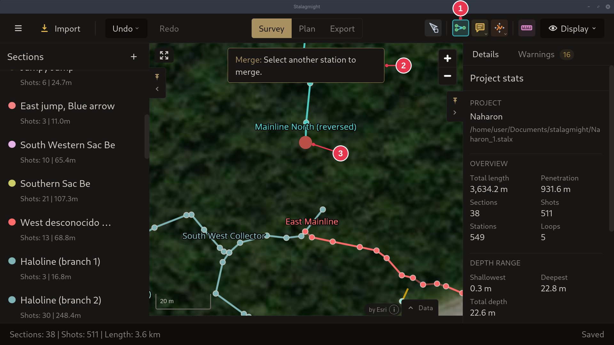
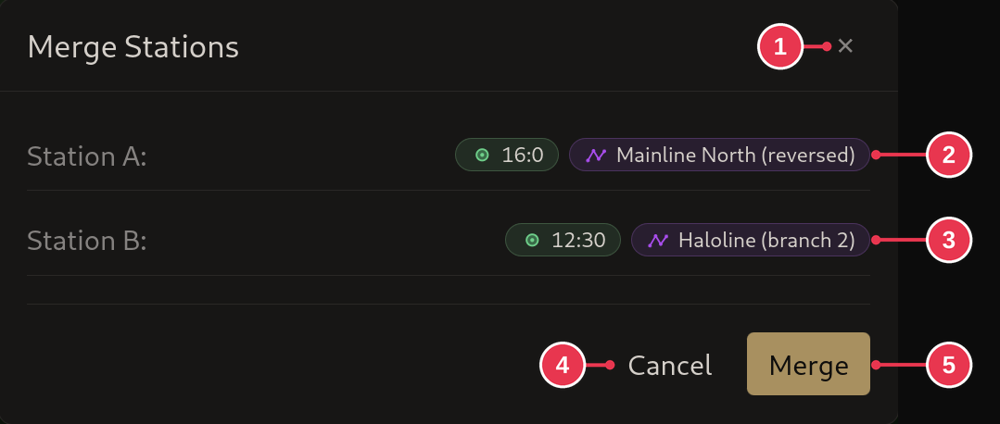
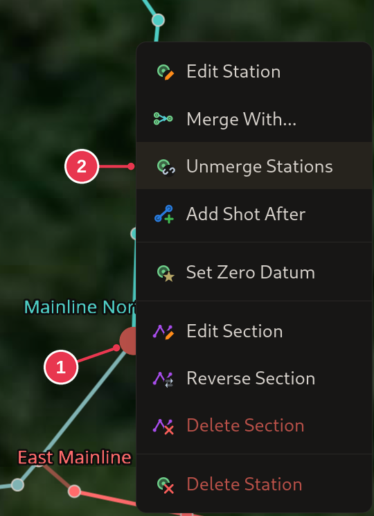

# Merging stations

Joins two sections at a shared station. Useful when a section could not be
placed from reference shots and was placed by hand.

1. In the [survey view](../screens/survey-view.md), pick **Merge** (`M`) in the
   toolbar.
2. Click the station to merge.
3. Click the station to merge it to.
4. Check the two stations in the [Merge Stations dialog](../screens/merge-stations-dialog.md)
   and click **Merge**.

Right-clicking a station and picking **Merge With...** does steps 1 and 2 in one
go. See the [station context menu](../screens/station-context-menu.md).

## Step details

### 1-2. Merge tool and first station

- **Merge** (1) is active.
- The first station (3) is picked. The banner (2) asks for the second.

### 3-4. Second station and confirm

- **Station A** (2) is the first station clicked, **Station B** (3) the second.
- **Merge** (5). The first station's section moves onto the second.

### Details

- After the second click, Stalagmight checks that the merge is possible. If the
  sections are already connected, or both are fixed, it offers a
  [loop closure](closing-a-loop.md) instead. Otherwise a notification says why.
- Which side moves, and when a merge is refused: see the
  [Merge Stations dialog](../screens/merge-stations-dialog.md).

## Unmerging stations

Right-click a merged station and pick **Unmerge Stations**. The unmerge icon
next to **Merged with** in **Details** does the same.

1. A merged station, right-clicked.
2. **Unmerge Stations**

A station merged with more than one other asks which merge to undo.
