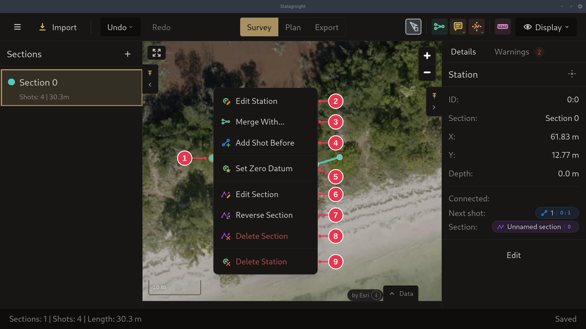
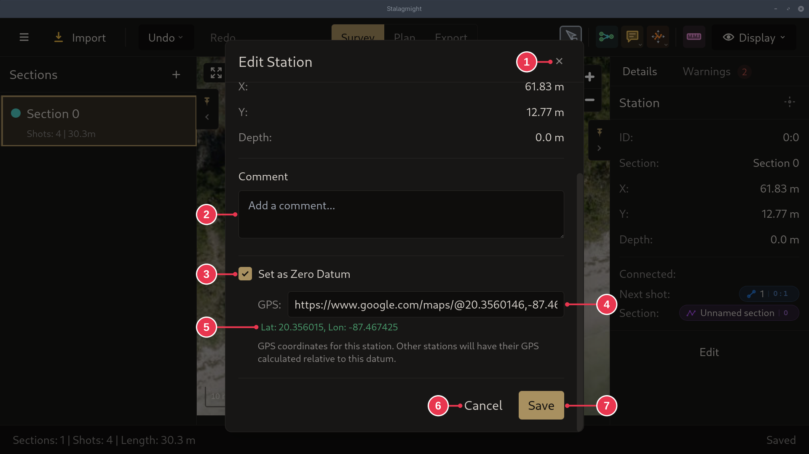

# Setting a zero datum

A [zero datum](../concepts/sections-shots-stations.md) ties one station to a
real-world GPS position.

1. Right-click the station on the map and pick **Set Zero Datum**.
2. Paste or type its GPS position, in any
   [supported format](../screens/edit-station-dialog.md#gps-formats), and
   click **Save**. The station moves to that position on the map.

## Step details

### 1. Set Zero Datum

Right-click the station (1) and pick **Set Zero Datum** (5). It opens the
[Edit Station dialog](../screens/edit-station-dialog.md) with the zero datum
switched on.

### 2. GPS position

- Paste or type the position into **GPS** (4). A Google Maps link works, as
  here.
- Check the latitude and longitude it read (5).
- **Save** (7). The station, and everything connected to it, moves to that
  position.
