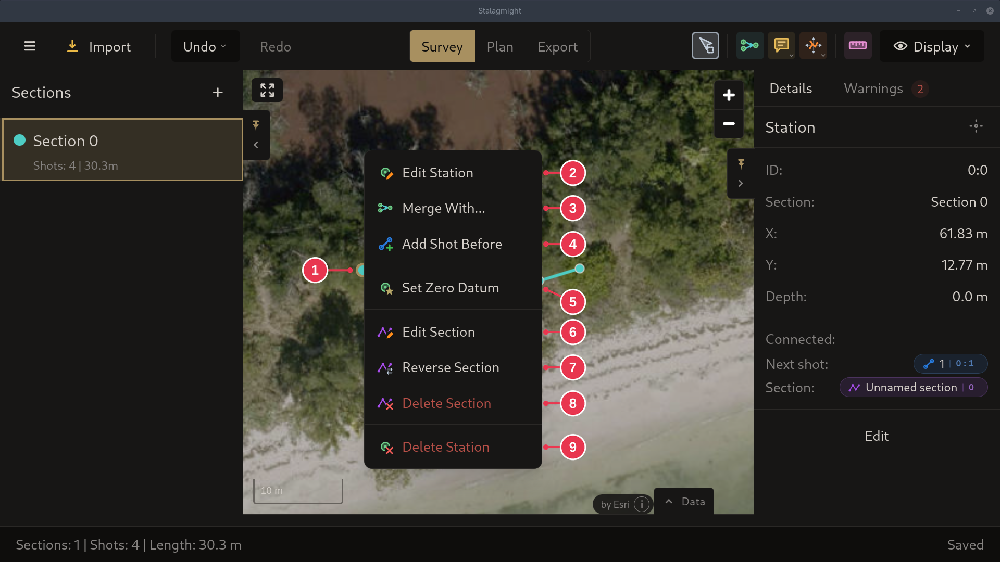
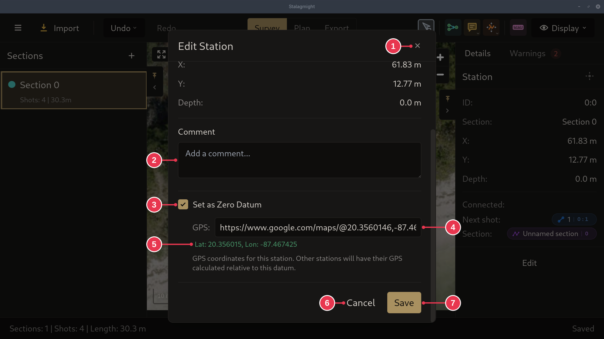

# Setting a zero datum

A [zero datum](../concepts/zero-datums-and-gps-fixes.md) ties one station to
a real-world GPS position.

1. Right-click the station on the map and pick **Set Zero Datum**.
2. Paste or type its GPS position, in any
   [supported format](../screens/edit-station-dialog.md#gps-formats), and
   click **Save**.

The first zero datum of a connected piece of the survey places it: the
station, and every station connected to it by shots and merges, moves to that
position. A later one on the same piece is a GPS fix and moves nothing in the
Raw Data View. See [Adding a GPS fix](#adding-a-gps-fix).

## Step details

### 1. Set Zero Datum

Right-click the station (1) and pick **Set Zero Datum** (5). It opens the
[Edit Station dialog](../screens/edit-station-dialog.md) with the zero datum
switched on.

### 2. GPS position

- Paste or type the position into **GPS** (4). A Google Maps link works, as
  here.
- Check the latitude and longitude it read (5).
- **Save** (7). For the first zero datum of a piece, the piece moves to that
  position.

## Adding a GPS fix

For a second entrance with its own GPS, or a radiolocation point.

1. Right-click the station and pick **Set Zero Datum**, as above.
2. Enter its GPS. The dialog says the survey already has a zero datum and that
   this one bends the Closures Computed View toward its GPS. Below, it shows
   how far the GPS is from where the survey puts the station, for example
   "GPS is 4.2 m NE of the surveyed position."
3. Set **Accuracy (m)**: leave 0 to pin the computed survey exactly to the
   GPS, or enter how far off the reading may be (a smartwatch is roughly 5 m).
4. Check **Entrance**. It is ticked by default at the first or last station
   of a line and unticked in the middle of one. Untick it for a point
   inside the cave, such as a radiolocation fix.
5. **Save**. Nothing moves in the Raw Data View. Switch to the **Closures
   Computed View** in the [Display menu](../screens/display-menu.md) to see
   the survey bent to the fix.

## Reading the gap

The gap is the distance and direction from where the survey puts the station
to its GPS. A small gap is normal survey error. When it is more than 15 m
plus 2% of the survey length from the placement datum, the dialog warns you:
check the GPS reading and the survey between the two zero datums. You can
still save, and the warning then also shows in the
[Warnings tab](../screens/warnings-panel.md). See
[The far GPS fix warning](../concepts/zero-datums-and-gps-fixes.md#the-far-gps-fix-warning).

## Details

- **Save** is unavailable in the Closures Computed View, Plan and Export.
  Edit zero datums in the Raw Data View in Survey mode.
- To remove a zero datum, open **Edit Station**, untick **Set as Zero Datum**
  and **Save**. Removing the zero datum that places a piece hands that role to
  the next one; see
  [How roles change](../concepts/zero-datums-and-gps-fixes.md#how-roles-change).
- Changing a GPS later: what moves depends on the zero datum's role; see
  [How roles change](../concepts/zero-datums-and-gps-fixes.md#how-roles-change).
- Changing only **Accuracy (m)** or **Entrance** moves nothing.
